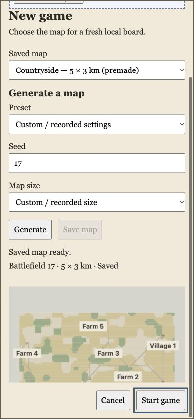
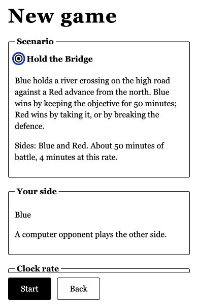

# Angular local session integration — A5 evidence

Source checkpoint: `c38727836520003bfe5d5419917fa465d7abbae3`, base `68bea3420e6aa5d1584597afc781d1a9b61e9356`. [PR #362](https://github.com/exterkamp/kriegsspiel/pull/362) is draft. This checkpoint is not final ready-head acceptance. Newer-main composition, final independent evidence review, current native media verification and final-head checks remain required.

The development-only `/dev/local-board` owns a certified map, private fresh personal scope and native Angular views. Settings → New game replaces the session only after old work and views retire. Ordinary production menu/auth/guest/scenario/live routing remains separate.

| Verification | Evidence and result |
| --- | --- |
| Complete source review | [27-path review](source-review.md), no new A5 P1/P2; [lifecycle repairs and meaningful assertion faults](lifecycle-repair-review.md) accepted at the explicitly preserved source hashes. Original inconclusive probes remain inconclusive. |
| Locked source checks | [Results](source-checks.json): setup, install, lint, typecheck, test, build exit0; 2,987 tests passed and three explicit opt-in server skips. |
| GitHub CI | [Independent artifact audit](ci-review.md), [run38319019440](https://github.com/exterkamp/kriegsspiel/actions/runs/38319019440): five jobs passed, four checkout artifacts and971 tracked sources match checkpoint. HQ clock mutations are separate from A5 faults. GitHub artifacts have30-day retention. |
| Browser source binding | [Current module manifest](current-served-source-manifest.json), [final campaign manifest](final-served-source-manifest.json). Actual served source-map contents equal copied sources; both validation and generation workers included. Raw emitted JS/maps remain local, never published as builds. Literal diagnostic checkpoint alone is not source proof. |
| Actual browser actions | [Action attempts](final-browser-actions.json), [complete observations](final-browser-observations.json). Native saved/generated Start, parent-template HMR during Setup/committed Start, actual product Retry/Default recovery and deferred startup across parent HMR. Injection controls are explicitly labeled. |
| Real generated file | [Readback manifest](generated-map-readback.json): generated `a84e4684-7181-47d0-9c5e-3c2d893a893d`,2,350,746 bytes, SHA256`ecce44a083ff6f5a616d9ffc6946b5ffa53023092396ba5230836f221c59f4ed`, exact canonical sidecar readback and session binding. Map data stays in preserved local storage. |
| Terminal cleanup | [Full final acknowledgment](final-retirement.json):93/93 resource records released,8/8 Worker terminate calls, zero canvases/dialogs, observer restoration pending0/failedfalse, proof retired. Archived before closing the owned proof tab. |
| Production exclusion | [HTTP/output checks](production-exclusion.json):22 built browser files, local route/default/catalog unavailable; retired fixture query ordinary shell. [Actual guest menu return](production-menu.txt). |

The narrow screenshot files are JPEG with matching extensions. Actual DOM dimensions establish responsive acceptance; older mislabeled captures whose DOM stayed1440×1000 are excluded. Still images do not establish reduced-motion behavior. The proof instance identifier may change on component recreation, and its computed media values must be refreshed after changing native settings.

Three heavy-render action observations timed out after the action was attempted; subsequent UI outcomes were observed without repeating Start/Retry/release. Their absence from the original action array does not establish that they never ran, nor returned success. The Save action label describes its trigger; settled Saved status and readback establish completion. Preserved catalog-read rejection history requires independent classification. No internal GPU/heap/thread reclamation, global network silence, cross-tab atomicity, natural BFcache, simulation correctness, production storage or session-resume claim is made.

[Artifact hashes](artifacts.json) bind these files. Prior accepted source/browser packets carry only through verified byte identity and inspected integration context. Final publication must add its exact delta/base/head and any remaining limits; this report never certifies its own future commit.
