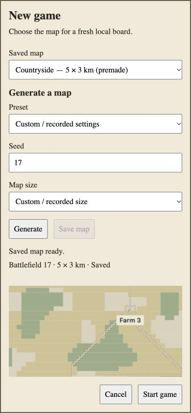

# A5 current-main source checkpoint

Source `04453f4a126f072d7731fa84749cf4a9a4ec8c9b`, tree `e75b971c875c8f43d5e1c6b72d60d18bccbd1d0d`, base/merge-base `c8e3ec61efe56846f462f105414a615401ef3e4a`. PR362 remains draft. Required native forced-colors/reduced-motion, old detached proof acknowledgment and recorded native focus restoration remain unwaived while Chrome is unavailable.

The [incoming review](incoming-review.md) covers all35 incoming paths/88 hunks and identifies no A5 code/config adaptation. [Composition carry](composition.json) verifies all20 implementation files plus Angular configuration retain exact3d787 bytes. Incoming architecture and decisions prefixes are preserved alongside local D36. [Inventory](inventory.json) binds the74-path candidate, including prior accessible evidence. [Earlier independently accepted production/evidence checkpoint](../current/README.md) remains bound to3d787 and its explicit limits; it is not relabeled as current-source evidence.

Fresh isolated [checks](checks.json) all exited0: map-source setup, locked npm ci, lint, typecheck, full tests and build. **3,101 passed, three explicit opt-in server skips.** Engine416, protocol64, maps262, server895, Angular563, plain client828, repository52 and catalog21. Node22.23.3/npm10.9.7, NG_BUILD_MAX_WORKERS=2. The sandbox-interrupted first setup is retained separately locally; it is not successful evidence. Complete six raw logs remain local and current-head GitHub validation supplies accessible execution records. [CI run38325642451](https://github.com/exterkamp/kriegsspiel/actions/runs/38325642451) passed all five jobs; independent exact-head artifact audit is recorded separately after completion.

[Actual current development source manifest](served-source-manifest.json) binds22 served modules/283 complete mapped source inputs with zero unresolved entries. It includes the actual updated optional protocol trait; it contains no private proof route/tooling. [Rendered native observations](local-browser.json) show current default ready, Settings focus/gating, real saved rectangle certification/Start enabled at390×844, Cancel restoring ready board/Settings focus, and settled ordinary menu/zero canvases after departure. Repeated ready observations resulted from interrupted artifact writes, not repeated page initialization. No fresh full focus-loop, media, generation or HMR result is inferred from this short trace; prior independently accepted unchanged-feature evidence retains its scoped carry.

[Production exclusion](production-exclusion.json) records eight actual HTTP responses and hashes all22 built files with zero hits for the enumerated local-feature tokens: development route/query/default/catalog GET+POST404; root/fixture query ordinary shell; old inspector bookmark reaches/map-table. [Preview isolation](preview-isolation.json) verifies own synthetic database, stub/scripted/test providers and disabled external mail. This is localhost verification, never deployment or publication of builds.

[Current production browser observations](production-browser.json) record native guest entry, native scenario selection/Start, running12:1 HQ, incoming own roster names/trait titles, leaving to menu with own game retained, later actual Victory at00:50 with stopped clock and settled game-over menu/zero canvases. This is an isolated smoke, not general gameplay acceptance. [Current screenshot](game-over.jpg) corroborates the outcome. The [prior supplement review](prior-supplement-review.md) independently accepts the accessible3d records within their exact source qualifications. Current candidate integration and CI audits remain separate pending reports. The matching-guest native sign-in request was left unsubmitted after automatic review rejected Send because the synthetic field could not be verified through browser readback. Current auth/guest/store tests passed; this interruption supplies no native sign-in acceptance. Prior3d signed-in/lobby/inspector outcomes remain their original source-bound checkpoint. No general upstream security/gameplay acceptance, production persistence, simulation expansion or local session resume is claimed.
