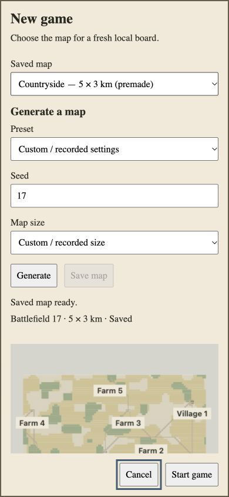
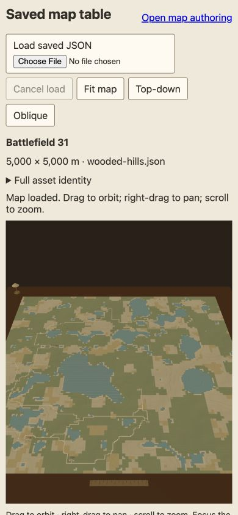
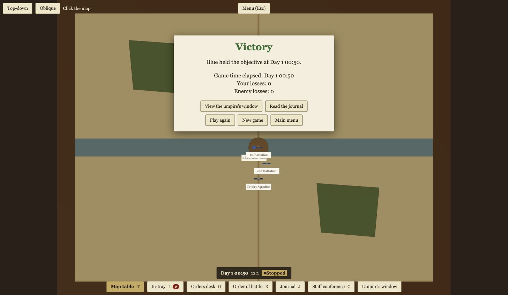

# A5 integration checkpoint on current-main composition

Reviewed source `3d787b66cffb475f543c09a72cbb682c2e231038`, tree `ed8994d2ca153fcb8be2606869122e56c4dbb2f5`, base `36406f70c485e7f23befb9f9b9e27fdfbd4c32e0`. This supplements the preserved [C387 checkpoint](../README.md). It is qualified source/evidence acceptance, not final readiness. Newer main `c8e3ec6` composition and required active native media checks remain pending.

[Independent integration review](integration-review.md) covers all43 owned paths and132 unchanged local/style inputs, full actual emitted source bindings, complete final resource records, normal native keyboard interactions and the fresh Retry case. [Exact-head CI audit](ci-review.md) verifies [run38321508158](https://github.com/exterkamp/kriegsspiel/actions/runs/38321508158), all five successful jobs, four artifact ZIP digests and992 tracked source entries. GitHub artifacts have30-day retention. The current full [local checks](checks.json) and six adjacent logs passed: **3,081 tests, three explicit opt-in server skips**. The initial evidence-formatting lint failure is retained locally; the successful rerun is distinct.

[Artifact hashes](artifacts.json) bind public bytes and original raw hashes. Source maps/emitted JS, private credentials and raw generated map data remain local; no build is published. JSON formatting preserves the complete observations semantically. Reports' referenced local frozen-copy directories are staging records, not downloadable GitHub artifacts.

| Acceptance boundary | Source-bound evidence |
| --- | --- |
| Actual shipped Angular route | [22 modules /283 mapped bindings](shipped-source-manifest.json), no private proof component or route; [132-entry source carry](source-carry.json) |
| Native keyboard and390×844 | [14 observations](keyboard.json): Settings focuses New game; settled Tab traverses Preset/Seed/size/Generate, reverse Tab reaches Cancel; Escape restores Settings and original board; route departure reaches ordinary menu/zero canvases |
| Fresh native Retry | [Exact selectors recorded before action](retry-actions.json), [six observations](retry-observations.json), [source manifest](retry-source-manifest.json), [30/30 released resources /2 terminated workers](retry-retirement.json). Explicit injected mount failure, actual product Retry same board, fresh empty same-map scope and later ready outcome |
| Parent-template HMR | [Exact heading-only overrides and graph hashes](hmr-overrides.json), [uncommitted Setup](setup-hmr-source-manifest.json), [committed replacement](committed-hmr-source-manifest.json), [deferred startup](pending-startup-source-manifest.json). Pair with the original campaign's complete observations and93-resource retirement; baseline graph plus override is not byte identity with an unmodified template |
| Production feature exclusion | [22 actual built files /zero chosen local-feature token hits](production-exclusion.json); local route/query/default/catalogGET+POST404; fixture query ordinary shell |
| Current real-server preservation | [Actual browser observations](production-browser.json), [explicit API-seeded lobby](lobby-seed.json), [persisted own Blue pin](live-mark-readback.json): native signed-in and guest invite/join, Ready/Leave/rejoin/reset, host Start, running12:1 HQs, order delivery estimate,50-minute stopped game-over and both menu returns |
| Current built inspector | Same browser observations: real rectangle and square certification, invalid schema replacement retains rectangle, native Cancel load retains rectangle;390×844 Oblique and Fit actions; [full displayed square identity](inspector-identity.txt) |

Labels describe operator intentions; actual state fields determine the result. Initial Setup focus is DIALOG, not the early label's Saved map; initial reverse Tab records BODY, so full focus-loop behavior is not claimed. The immediate Retry outcome is mounting; its later row is ready. Early lobby/menu snapshots can be Loading or stale polls; settled rows establish outcomes. Leave seat is immediate, whereas Remove player opens a confirmation; the earlier “Leave confirmation” label does not establish a dialog. The inherited Remove confirmation remains open after Escape, then explicit Cancel retains the participant. This is separately owned upstream behavior, not an A5 repair or blanket lobby acceptance.

The first current file-chooser call returned after a long delay, then real certification and displayed rectangle were independently observed. Subsequent bounded chooser calls completed, including unsupported-version replacement, cancellation and square loading. Native file-picker Cancel is not inferred from Cancel load; the prior empty-file-list automation attempt is unsupported. Native Chrome remains unavailable for current forced-colors/reduced-motion checks and old detached proof-tab acknowledgment/focus restoration. Those gates remain unwaived.

Original three interrupted heavy-render action observations remain qualified; the fresh separate Retry trace does not rewrite them. The catalog-read rejection history is compatible with supersession but its exact cause is unproven. Explicit result/acknowledgment holds and injected persisted-page events are not natural BFcache. Observations establish delegated cleanup acknowledgment and Worker terminate invocation, not GPU/thread reclamation or global network silence. Local mode has no production session storage, simulation or resume. The real-server smoke uses a synthetic local database, disabled external mail, scripted/test providers and an explicitly API-seeded lobby; it proves usable routing/interactions, not general combat/LOS/model security correctness.
