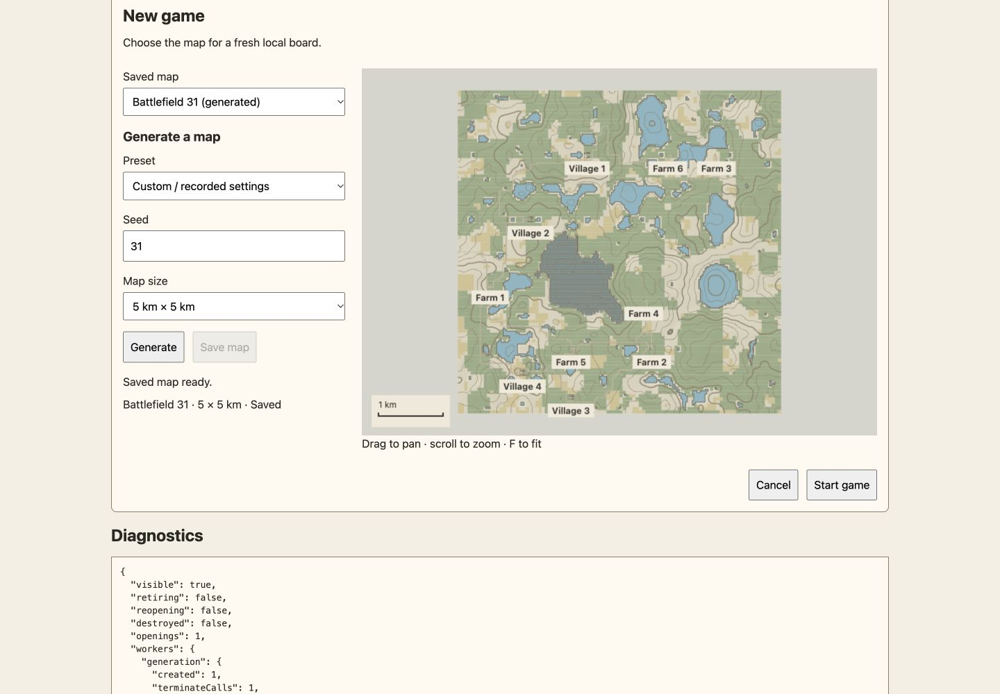
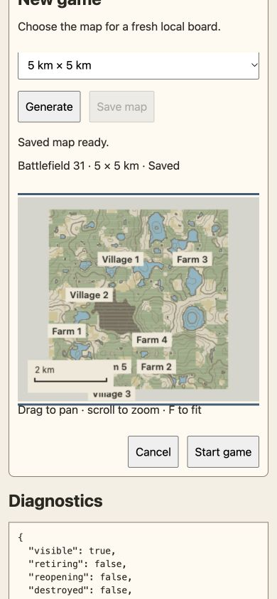

# Native Angular setup verification

The actual SetupComponent at source commit `79a3c4daeb4f06b6464017d0529bcc029e0d32f7` was rendered in an isolated managed development preview. The temporary wrapper is excluded from canonical application code; it used the real HTTP catalog, native certification/generation workers and MapPreview Canvas2D painter. Exact source hashes, observations and owned counters are in [browser.json](browser.json).

Desktop 1440 × 1000 and narrow 390 × 844 had no horizontal overflow. Native saved selection certified the pinned rectangle. Invalid seed -1 disabled eligibility. Wooded-hills settings, seed31 and5 km size generated a certified map, saved it, and selected the returned reference. The exact Start JSON matches catalog readback byte-for-byte and hashes to the full recorded asset identity. F-to-fit retained canvas focus.

Two actual setup-template HMR replacements each disposed the prior preview, mounted and painted the replacement, and preserved recipe, certified board, saved reference and Start eligibility. Original source was restored exactly. Start ran once and awaited setup disposal from inside its callback without self-await; zero owned workers/previews remained. Reopening followed retirement. Cancel during a real active generation terminated the worker and disposed the preview before its one callback; zero owned resources remained. No browser error/warning was captured.

This establishes the independent setup packet, not the future application route, modal focus trap, personal drafts or whole-session replacement. Those remain A5 integration gates. The 50 native focused tests and independent source review are separate from browser evidence. Targeted fault probes detected saved-option selection and stale metadata precedence; the Start-lock recipe was unmatched and unexecuted.

