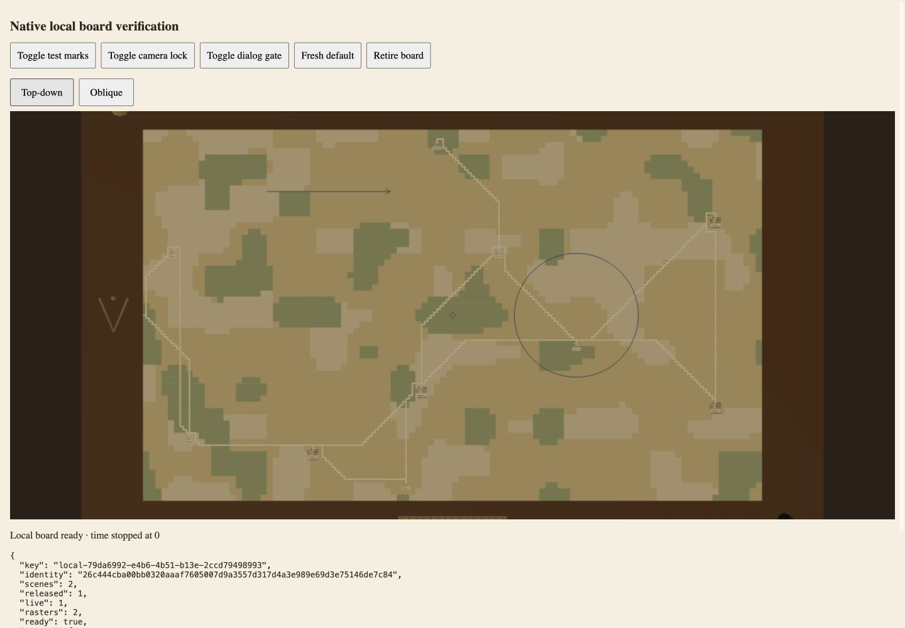
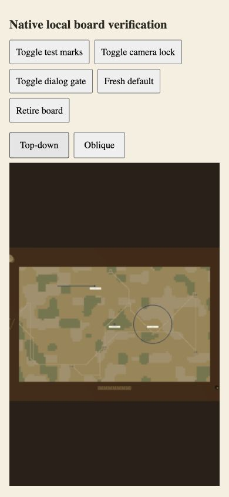

# Native Angular fixed-board verification

Source checkpoint `759f6e604435e87cdd2570e9d93c914ed42ed28b` was rendered in an isolated managed development preview with the real native certification worker, fixed-map raster painter and Three.js WebGL renderer. Eight source hashes match the frozen candidate and restored proof snapshot; [browser.json](browser.json) records bindings, owned counters and limitations. Diagnostic routes/wrapper are absent from canonical application source.

The pinned 5000 × 3000 m rectangle paints with stopped time and no pieces. Render-only pin/ring/arrow updates retain the raster. Camera lock preserves metre picking; a native centre click emits a keyed point at x2500/y1499.762. Full interaction lock suppresses another point. Top-down/Oblique and canvas Arrow-key controls remain usable. Desktop 1440 × 1000 and narrow 390 × 844 have no horizontal overflow.

Two actual host-template HMR replacements each retire the prior scene and create a replacement with the same session key and retained raster. Cumulative scene counts move2→4 and disposal calls1→3; raster count remains2. A prior temporary parent-wrapper style edit had recreated the entire host and produced that second raster; it is disclosed, and whole-parent HMR composition remains A5 acceptance work. Source restoration matches all eight hashes. Explicit retirement yields4/4 scene disposal calls and no owned live scene; narrow startup cancellation creates no late scene. No captured browser errors/warnings. These counts describe calls on actual owned renderer instances, not GPU memory reclamation.

The 74 focused tests establish hash/geometry/lifecycle failures with doubles separately. Personal persistence, final route, modal, session replacement and whole-parent template ownership remain A3b/A5 gates.

