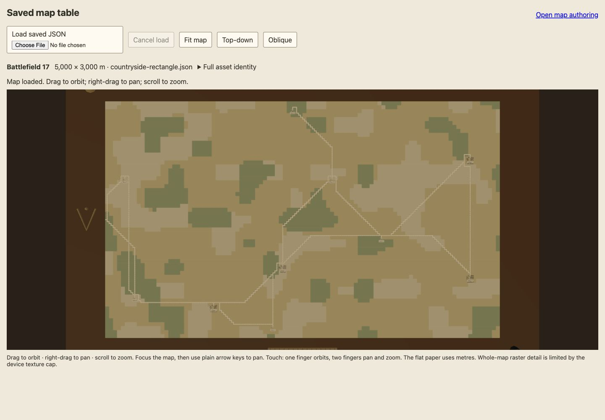
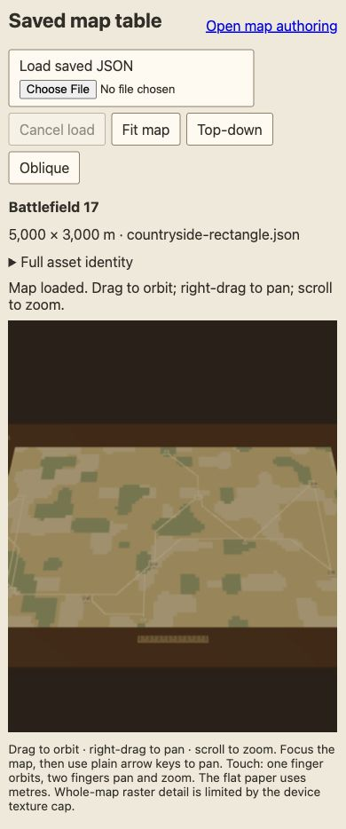

# Native Angular saved-map inspector browser checkpoint

Managed Angular preview `http://127.0.0.1:41930/map-table`, task API41932. Chrome on macOS, actual file chooser, native complete-certification worker and WebGL; no raster/worker doubles. Canonical rectangle full identity `26c444cba00bb0320aaaf7605007d9a3557d317d4a3e989e69d3e75146de7c84`.

[Source-bound measurements](browser.json) record the exact source-file hashes, viewport sizes and resource/registration diagnostics. These are browser observations; final candidate/root checks/independent review/CI are recorded separately in the landing log and PR. Screenshot bytes are JPEG.

## Desktop: 1440 × 1000, top-down

## Narrow: 390 × 844, oblique

Both have one canvas and no horizontal document overflow. The 5000 × 3000 metre rectangle uses texture4096 ×2458 with fractional content height2457.6, preserving bounds. Invalid JSON and a cancelled river-valley replacement keep the rectangle and its identity. Fit, top-down, oblique and focused arrow-key panning were exercised with no console errors.

Actual Angular template HMR was triggered by a temporary heading edit and restoration. The initial candidate incorrectly retained metadata over a blank replacement canvas. The repair tracks canvas identity, retires the old mount and starts an honest empty inspector; saved-file loading works after both replacements. Temporary edits are removed. Deterministic Angular view-recreation and detached OrbitControls regressions fail the original source and pass the repair; they supplement the browser observations.

This checkpoint does not establish local New game, personal marks, notebook or session-replacement acceptance.
