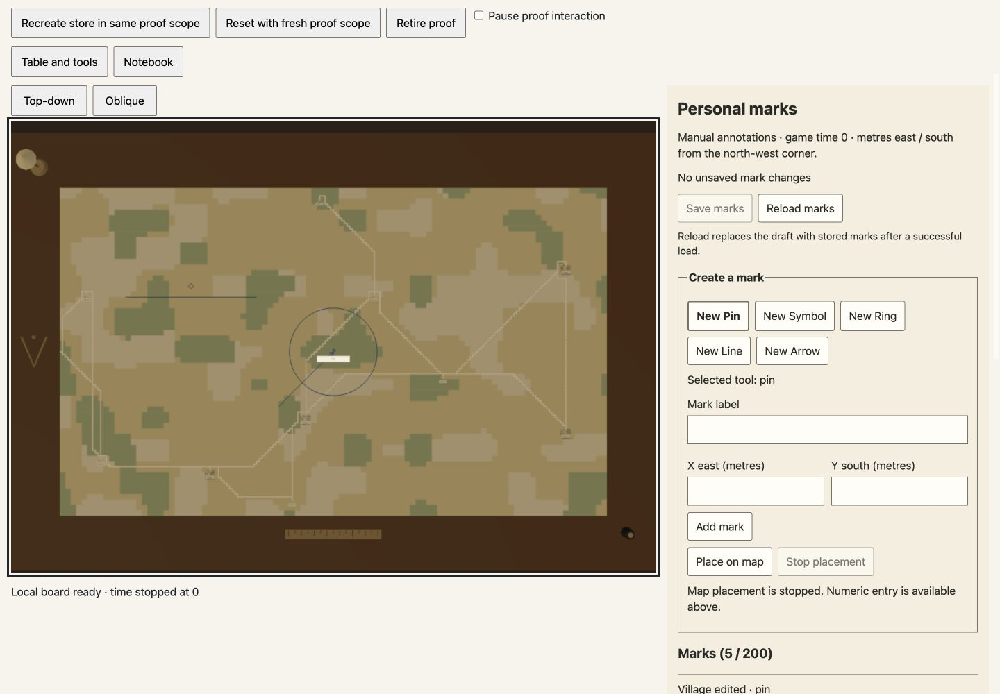
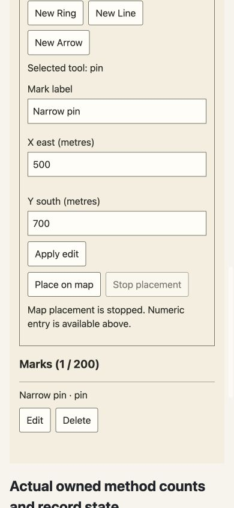
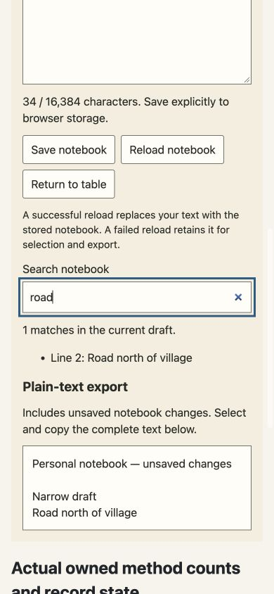

# Native personal features browser verification

Real Chrome, native Angular tools/notebook, default certification worker, Three WebGL, raster and browser localStorage were exercised in a source-frozen isolated managed preview. The temporary wrapper is excluded from canonical application code. [Machine-readable evidence](browser.json) binds twelve restored source hashes to source commit `b16c0503e6c62ec383016bf411cfa43b85475538` and documents instrumentation limits.

Desktop proof uses1440×1000; narrow proof uses390×844, each with document width equal to viewport width. Screenshots are actual scrolled views of native controls.

## Exercised behavior

- Create all five manual tools: fractional numeric pin/ring, explicit camera-locked canvas flag, ordered numeric line with point replacement, numeric/canvas arrow with Finish. Edit keeps mark ID/provenance; delete then Reload reads saved marks. Input Escape preserves armed placement; canvas Escape stops placement and retains points.
- Five marks save to real scoped localStorage. Explicit proof-only same-scope owner recreation reads all five matching records and notebook text; navigation preserves unsaved notebook text. Search trims whitespace and ignores case; literal angle brackets remain text. Narrow selectable export exactly equals the unsaved draft with its header.
- Settled full-interaction gating disables native inputs/actions while retaining records. Fresh proof scope loads empty marks/notebook on the same certified map without deleting prior records. No application resume pointer or selector is added.
- Mark operations reuse the first raster. Explicit proof owner recreation allocates the second raster; two real personal-tools template edit/restore HMR replacements preserve that second raster, scope, marks and notebook. All twelve canonical/snapshot source hashes match after restoration. Whole-parent HMR belongs A5.
- Desktop explicit lifetime operations retire three scenes/surfaces/stores/repositories; narrow retirement releases its one owner. Zero owned live scenes remain; captured error/warning lists are empty. Counts measure real method calls/acknowledgements, not browser GPU reclamation or native worker/listener totals.

Corrupt/future/quota/conflict/reentrancy/cancellation boundaries use the separately bound unit-port tests; no browser quota exhaustion or corruption injection is claimed. Full app route, modal behavior, replacement, parent HMR and fresh application reload remain A5 acceptance.
