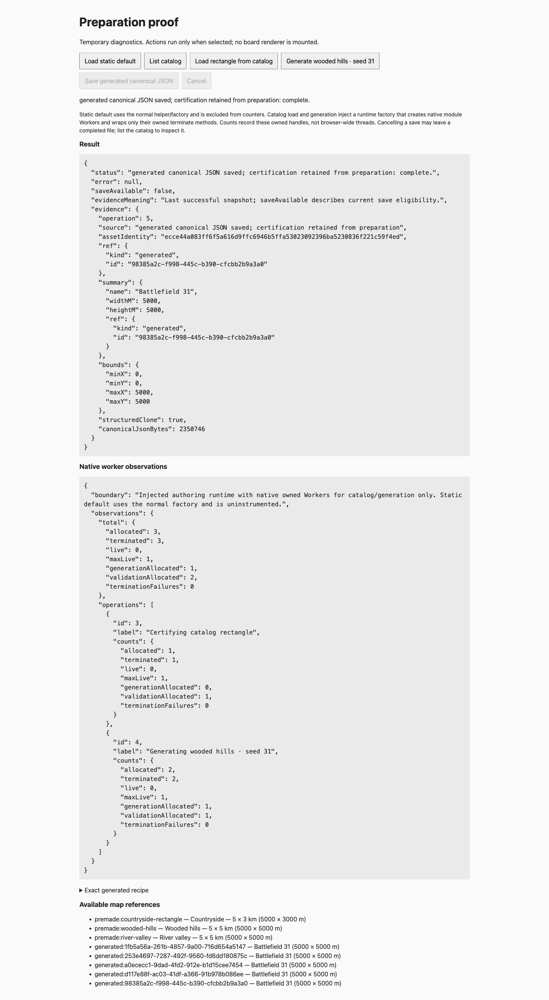
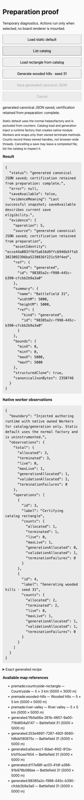

# Certified preparation browser evidence

This is a temporary diagnostic harness in an isolated Angular snapshot, not delivered New game UI. The harness source hash, actual source hashes and complete observed DOM snapshots are in [browser.json](browser.json). Native module workers certified the pinned 5000 × 3000 metre default, loaded and certified catalog bytes through the Angular origin, generated wooded hills seed 31, saved exact canonical bytes, and cancelled actual generation. Saved readback SHA-256 equals the generated identity.

The stopped task catalog produced a visible HTTP 502 error; with both task API and catalog stopped the normal static-default helper still certified the exact pinned rectangle. Protected previews were untouched. Injected native-worker counters cover owned catalog/generation handles only: 4 allocations, 4 terminations, zero live and zero termination failures after cancellation. The default helper's normal worker factory is uninstrumented. These are not browser-wide resource totals or session replacement acceptance.

A production build of the isolated snapshot succeeded and contained no development default assets; its production route file replacement excluded the diagnostic component. Canonical shipped source contains no harness or route. Final exact-head full checks/CI and source review are recorded outside the head.

Desktop 1440 × 1000 and narrow 390 × 844 captures show diagnostic output, not a product layout verdict. Chrome on macOS; no broader device coverage claimed.

