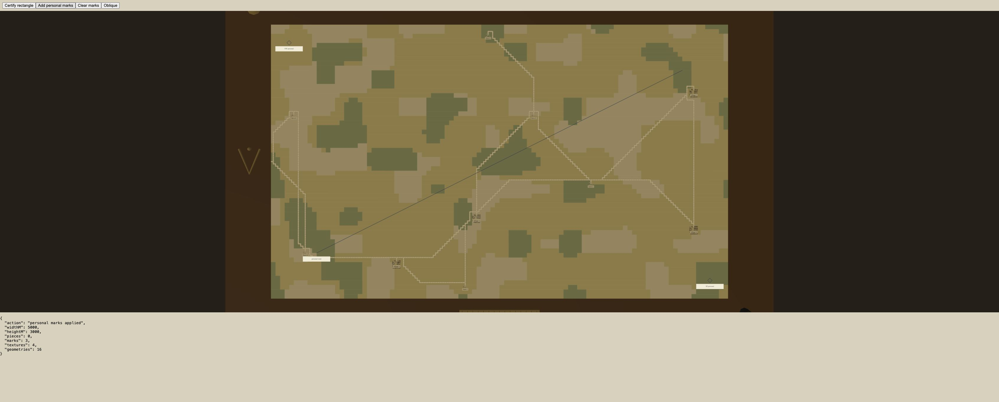
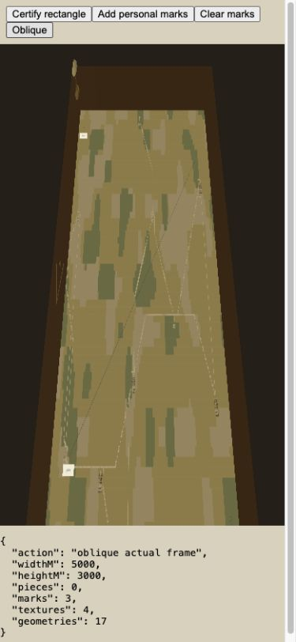

# Fixed local board browser verification

Managed preview at `http://127.0.0.1:41930`, based on main76f284e with the frozen reference fixed-board scene extraction. A disposable harness used the real saved loader and validation worker with the canonical rectangle (seed17,5,000×3,000 m), then the actual local scene APIs and WebGL. No harness or fixture copy ships.

The first cold certification attempt reached the existing30-second watchdog; a retry completed. This is not a timing or cold-start performance acceptance.

Desktop top-down view rendered NW/SE personal pins and a diagonal personal polyline with zero game pieces. Narrow390×844 override rendered the same board obliquely. Clearing all three marks returned renderer texture count from4 (paper plus label textures) to1; the paper remained. No console errors or warnings were observed. Narrow document scroll width375 fit its viewport. Device/touch gestures and exhaustive performance remain outside this check.

