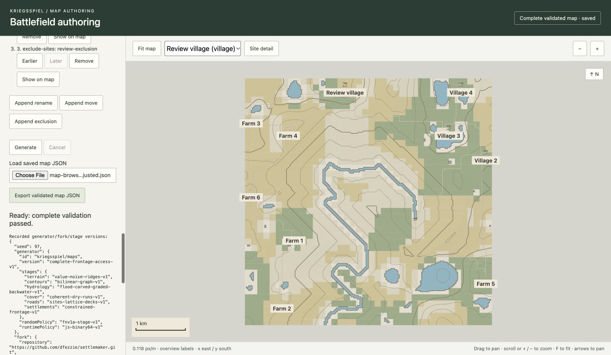

# Standalone map verification evidence (#142)

Recorded on 2026-10-10 for accepted generation source `94e0524` and authoring source `86cfb2a`. The final headless corpus contains **21 distinct seeds: 20 valid complete maps and one bounded connectivity infeasibility**. The required 5 km representatives flat17, hills31 and river97 succeed. The recorded default 10 km and maximum 15 km cases meet the documented Node time/RSS targets under the explicit resource profile below. Actual Chromium authoring, adjusted replay and preview measurements pass the tested gates.

This report preserves measured evidence and its limits for review. It does not authorize merging, deployment or combined-work distribution. Issues remain open until the implementing PR is merged.

## Source and environment

| Item                             | Recorded identity/profile                                                                    |
| -------------------------------- | -------------------------------------------------------------------------------------------- |
| Kriegsspiel accepted G revision  | `94e05244a6b1adeb6162a41e7652323c0a2f936f` (`94e0524`)                                       |
| Consumed SettleMaker fork        | `e08ec2e09f9a15f9110a3048123a31a58d08c341`                                                   |
| Fork tree                        | `dd79e4a4e7644e81e1417fb7d945ee85be58b919`                                                   |
| Corresponding-source tar SHA-256 | `eb6a44f6b8bfa0e49cb2f27abb419a1a8766734cf95ab930f342d39c212ba5ca`                           |
| Consumed npm tarball SHA-256     | `df41ca6e340f068f68600be702a74d3db74e165a4f61727916279ccfd3785f84`                           |
| Machine                          | Apple M3; Mac15,3; 8 logical CPUs; 16 GiB RAM                                                |
| OS                               | macOS 27.0.1, build 26A434                                                                   |
| Runtime                          | Node `v22.22.2`, Darwin/arm64                                                                |
| Child process flags              | `nodeExecArgv: ["--max-old-space-size=256"]`; `nodeOptionsUsed:false`                        |
| Heap profile                     | 256 MiB V8 **old space**; recorded total V8 heap limit **304 MiB**                           |
| Asset/validation policy          | `kriegsspiel/local-map` v1; `decimal-6-v1`; `complete-frontage-access-v1`; `complete-map-v1` |

The source/artifact identities are distinct: the complete corresponding-source archive is not the consumed npm tarball. The [source-review bootstrap](../vendor/settlemaker/README.md) retains attribution, original notices and the package's SHA-512 integrity. Generation consumes that installed artifact, not the ignored fork/prototype. [D23](decisions.md#d23-review-builds-consume-an-attributed-integrity-pinned-local-source-artifact) keeps publication/combined distribution gated.

Hardware and accepted checks are recorded in the [execution log](map-execution-log.md); resource targets/profile are in the [architecture](map-architecture.md#configurable-assumptions). The accepted G checkpoint reports root build/lint/typecheck/test exit 0 and 672 tests (651 Vitest + 21 Node). Those component/integration checks are separate from this resource corpus.

## Evidence and measurement method

The authoritative local records are:

- [Final corpus](map-verification/corpus.json): 21 fresh child-process records, including full materialized recipes, identities, counts and the infeasible diagnostic.
- [Final default](map-verification/default.json): unchanged 10 km default recipe, seed17.
- [Final maximum](map-verification/maximum.json): 15 km flat-countryside recipe, seed17.
- [Earlier unprofiled default](map-verification/unprofiled-default.json): successful content with a failed RSS target, retained below.

The coordinator's [single-case harness](../scripts/maps-verification/case.mjs) loads the accepted built package and times the synchronous `generateBattlefield` call using `performance.now()`. This **generation time includes the pipeline's own canonicalization and complete validation**. Module startup precedes the timer. Ambient `Math.random` and `Date.now` throw during generation. These guards demonstrate those forbidden calls were not used in these runs; they do not constitute repeated-generation replay proof.

On success, a separately timed `validateBattlefield` call independently certifies the saved geometry. Canonical geometry/asset SHA-256 computation and any optional file serialization follow that timer. The corpus does not regenerate each recipe a second time or compare browser/CLI output.

`process.resourceUsage().maxRSS / 1024` converts Node's KiB measurement to MiB. **Generation RSS** is the process-lifetime high-water mark sampled immediately after generation, including startup/imports. **Post-check RSS** is the later process-lifetime high-water mark after independent validation, identities and any optional output write. These are successive cumulative peaks, not phase-local allocations, heap usage or memory deltas. They include native/external memory. The old-space flag does not guarantee a 512 MiB RSS limit; that target must be measured separately. Browser page/worker memory is not inferred from Node RSS.

The [corpus harness](../scripts/maps-verification/corpus.mjs) serializes cases, starts one fresh process per recipe with the flag explicitly in the child's argument list, and applies a 120 s process timeout. Parent flags alone are not relied upon. Recipes retain 25 m samples, full counts/populations and accepted grade/geometry/work caps. All recorded overrides are empty. Reproduction commands for the same profile, using new output names to retain the frozen records:

```sh
node --max-old-space-size=256 scripts/maps-verification/corpus.mjs /tmp/map-corpus-repeat.json
node --max-old-space-size=256 scripts/maps-verification/case.mjs default 17 10000 > /tmp/map-default-repeat.json
node --max-old-space-size=256 scripts/maps-verification/case.mjs flat-countryside 17 15000 > /tmp/map-maximum-repeat.json
```

These are reproduction commands. The CLI's supported root `maps:cli` command applies the same old-space flag.

## Final 5 km seed corpus

Flat = `flat-countryside`, Hills = `wooded-hills`, River = `river-valley`. The final list is seven distinct seeds per preset and **21 distinct integers overall**, not the earlier proposed 24 recipes sharing eight seeds. Every valid record independently reports connected geometry, 10 sites (4 villages + 6 farms), 318 buildings and 1272 assigned residents. Full configured demand is retained: 300 per village and 12 per farm. Required-river cases have used linked bridges under complete validation, including river97's one bridge.

Times are seconds; RSS is generation/post-check MiB. W/B/C means water features/bridges/contours. Geometry SHA-256 prefixes are shown for compact comparison; the raw records retain full hashes. The infeasible case has no accepted geometry/counts/hash.

| Preset | Seed | Result     | Generate s | Saved check s | RSS MiB gen/post | Roads | W/B/C       | Geometry SHA prefix |
| ------ | ---: | ---------- | ---------: | ------------: | ---------------: | ----: | ----------- | ------------------- |
| Flat   |    0 | Valid      |      1.881 |         0.357 |   170.17 /194.42 |  1623 | 0 /0 /0     | `da13f68a0dbd`      |
| Flat   |    1 | Valid      |      1.824 |         0.350 |   163.38 /188.75 |  1601 | 0 /0 /0     | `00b829e8fdc8`      |
| Flat   |    2 | Valid      |      2.003 |         0.363 |   162.92 /191.06 |  1781 | 0 /0 /0     | `f60b71a14594`      |
| Flat   |    7 | Valid      |      2.082 |         0.335 |   164.45 /180.03 |  1519 | 0 /0 /0     | `ea7c751b8364`      |
| Flat   |   17 | Valid      |      1.841 |         0.337 |   171.00 /183.78 |  1686 | 0 /0 /0     | `5a55576634e5`      |
| Flat   |   23 | Valid      |      1.862 |         0.333 |   172.64 /190.23 |  1739 | 0 /0 /0     | `7e46267fe963`      |
| Flat   |   41 | Valid      |      1.792 |         0.328 |   171.23 /189.77 |  1658 | 0 /0 /0     | `ec9b88fa39ab`      |
| Hills  |    3 | Valid      |      2.839 |         0.524 |   210.45 /219.14 |  1718 | 72 /0 /142  | `2d5504895c9f`      |
| Hills  |    5 | Infeasible |      0.573 |             — |   138.31 /138.31 |     — | —           | —                   |
| Hills  |   11 | Valid      |      3.174 |         0.543 |   206.17 /215.02 |  1639 | 94 /0 /130  | `83b6a469353e`      |
| Hills  |   19 | Valid      |      2.720 |         0.547 |   201.48 /221.22 |  1843 | 79 /0 /124  | `dc8dc5f1b813`      |
| Hills  |   31 | Valid      |      2.997 |         0.686 |   218.63 /218.63 |  1570 | 157 /0 /133 | `85c62f1eed03`      |
| Hills  |   43 | Valid      |      2.909 |         0.548 |   204.13 /213.28 |  1731 | 95 /0 /126  | `19109bd5c9e2`      |
| Hills  |   59 | Valid      |      3.263 |         0.631 |   191.36 /203.47 |  1773 | 64 /0 /117  | `2af04ea2561f`      |
| River  |   13 | Valid      |      3.534 |         0.533 |   201.56 /221.64 |  1627 | 34 /1 /30   | `3e22f614ce43`      |
| River  |   29 | Valid      |      3.415 |         0.440 |   201.13 /214.23 |  1724 | 23 /1 /25   | `985966f99cef`      |
| River  |   47 | Valid      |      3.411 |         0.492 |   197.75 /222.52 |  1682 | 29 /2 /34   | `881620b7dd39`      |
| River  |   61 | Valid      |      3.698 |         0.550 |   198.88 /225.08 |  1653 | 20 /1 /37   | `9a3dbdfe67b3`      |
| River  |   73 | Valid      |      5.138 |         0.542 |   195.66 /216.33 |  1605 | 14 /1 /34   | `2d026bba1839`      |
| River  |   89 | Valid      |      3.556 |         0.506 |   208.06 /222.33 |  1588 | 25 /1 /36   | `7908ca7962d7`      |
| River  |   97 | Valid      |      3.372 |         0.433 |   224.20 /225.30 |  1845 | 25 /1 /38   | `d052dd59c25f`      |

The exact wooded-hills seed5 diagnostic is `REGIONAL_CONNECTIVITY`, stage `validation`, constraint `required terminals`: “Required sites and boundary exits cannot all connect through certified ground/deck edges.” It terminated in 572.539167 ms at 138.3125 MiB with no partial successful asset. The recorded seed remains in the corpus; no replacement, reduced counts or relaxed grade was used. This bounded infeasibility is permitted by the implementation plan; it is not a valid map. All three required representatives succeeded.

For the 20 valid cases, generation ranges 1.792–5.138 s (median 2.953 s), separate saved validation 0.328–0.686 s, generation RSS 162.92–224.20 MiB and post-check RSS 180.03–225.30 MiB. These are single observations per fixed recipe on one machine, not percentile estimates or universal success guarantees.

## Default and maximum resource observations

| Recorded case                          | Grid / samples  |  Generate s | Saved check s |       RSS MiB gen/post | Result                               |
| -------------------------------------- | --------------- | ----------: | ------------: | ---------------------: | ------------------------------------ |
| Default10×10km, seed17                 | 401×401 /160801 | 6.867900333 |   1.357414166 | 268.343750 /294.062500 | Valid                                |
| Maximum15×15km, flat17                 | 601×601 /361201 | 8.588681333 |   1.661070875 | 354.781250 /354.781250 | Valid                                |
| Earlier unprofiled default10km, seed17 | 401×401 /160801 | 6.198683708 |   1.754961917 | 578.171875 /578.171875 | Valid content; **RSS target failed** |

The final default is the unchanged default relief 100 m recipe, with 96 water features and 102 contours. The maximum case is the actual flat-countryside preset at 15 km, relief 0, with 25 m resolution and full settlement demand. It exercises the maximum supported sample grid and real composition. It does not establish a worst-case 15 km hills/river bound.

| Case                 | Cover | Water | Nodes | Roads | Bridges | Sites | Buildings | Labels | Contours | Assigned |
| -------------------- | ----: | ----: | ----: | ----: | ------: | ----: | --------: | -----: | -------: | -------: |
| Final default17      |  1620 |    96 |  2393 |  2408 |       0 |    10 |       318 |     10 |      102 |     1272 |
| Final maximum flat17 |  2766 |     0 |  3500 |  3519 |       0 |    10 |       318 |     10 |        0 |     1272 |

Both final saved certificates report `connected:true` and `complete-map-v1`. Reported validation work is 60806109 for default and 63878194 for maximum, within the unchanged 100 million complete-validation cap. [Composition policies](../packages/maps/docs/composition.md) explain actual footprint, corridor, bridge, population and graph certification.

The measured cases meet the architecture's ≤10 s default/≤30 s maximum generation and ≤512 MiB peak targets **under the recorded 256 MiB old-space profile**, including their later process high-water marks. The earlier 578.17 MiB diagnostic exceeded 512 MiB despite successful generation/validation. It remains a failed memory-target observation; an unrestricted Node heap is not the supported measurement profile. No claim is made that the V8 flag itself limits total RSS or browser memory.

Exact canonical identities retained in the records:

| Case                 | Geometry SHA-256                                                   | Asset SHA-256                                                      |
| -------------------- | ------------------------------------------------------------------ | ------------------------------------------------------------------ |
| Final default17      | `459bc10f4780fd3dc642b1d11fe72fe033eae62d7bb0bf1f1b7ffe6080076f45` | `2e3508a5f24ff0473403875179037aa54c1e1932a0d159a918172a09cad0902b` |
| Final maximum flat17 | `1d7562f2c463fba1cc9cb92ce2086c5970a6a0683a7f71cefb34561caeba132c` | `24dd102e722d5755303faaf257a033aa48c5413a1fe032c5e89dfe422b6da89b` |

The earlier unprofiled default record has exactly the same two hashes and feature counts as the final default. That recorded comparison preserves the earlier diagnostic while showing unchanged content; it is not a substitute for the separate current-source CLI/browser replay gate.

## Browser authoring and replay

Actual Chrome154.0.8037.95 runs on the same machine generated and independently certified all three representatives. Authoring screenshots use a1456×846 browser viewport, with overview, named village detail and plain high contrast. Roads, actual building footprints, contours/cover/water and the river's64m bridge align with exported local-metre coordinates. Keyboard pan, anchored wheel zoom, fit, named detail and contour toggling work without modifying exported data.

Browser downloads match Node canonical full JSON SHA-256, which also proves canonical geometry equality:

| Recipe           | Full asset SHA-256                                                 |
| ---------------- | ------------------------------------------------------------------ |
| Flat17           | `6305b91faa19915eeea48e0bb473d900415ff00584fce318866d4e79e883926a` |
| Hills31          | `ecce44a083ff6f5a616d9ffc6946b5ffa53023092396ba5230836f221c59f4ed` |
| River97          | `bf704cc07170dcf9b7587c11bee7db54139220ef9b8a69384c01f4de68b7aba2` |
| Adjusted river97 | `c3fb36409721baaf41cc82445a07f3f6dc1210ea576c0bfa7b6c2f334080cd29` |

The adjusted recipe renames `site:village:0000` to Review village, moves(2000,125)→(2025,125), and adds exclusion `review-exclusion` with outer ring `[[2500,0],[2525,0],[2525,25],[2500,25],[2500,0]]`, no holes. Real generation and complete certification succeeded. Saving, loading without generation, re-exporting, regenerating and fresh-process CLI replay all produced the same adjusted JSON. Three rapid requests89→73→97 published only the final97 result, with that same hash. Presentation changes also preserved it.

Invalid width disables generation/export before work. Moving the village to(2500,5000) fails `SITE_OVERRIDE_UNSUITABLE`; cancellation retains the last certified preview. Malformed `{}` rejects `INVALID_SAVED_ASSET`; changed recorded generator version rejects `UNSUPPORTED_REPLAY`. Every rejected/pending candidate disables JSON/SVG export and has visible recovery diagnostics. The final supported adjusted file reloads to ready. No game/LLM service or live hidden state participates.

Actual screenshots: [flat overview](map-verification/screenshots/flat-overview.jpg), [flat detail](map-verification/screenshots/flat-detail.jpg), [hills overview](map-verification/screenshots/hills-overview.jpg), [hills detail](map-verification/screenshots/hills-detail.jpg), [river overview](map-verification/screenshots/river-overview.jpg), [river detail](map-verification/screenshots/river-detail.jpg), [high contrast](map-verification/screenshots/river-detail-contrast.jpg), [bridge](map-verification/screenshots/river-bridge.jpg).



## Actual preview measurements

Each real representative ran30 warmup and240 measured translated-fit/zoom operations through the actual preview RAF observer, with all layers enabled. The canvas is1440×900 CSS/backing pixels at DPR1 inside a1800×1400 foreground viewport. Focus/visibility/resize/DPR changes invalidate the complete run. With output cleared during measurement, the canvas rectangle was fully visible (observed river position x9/y209.875). JSON output grows only after publication. No other generation/build suite ran during frame sampling.

| Recipe  | Worker generation/validation/export ms | Synchronous preview setup ms | Load + first frame ms | p95 RAF interval ms | p95 synchronous draw ms | Max RAF interval ms |
| ------- | -------------------------------------: | ---------------------------: | --------------------: | ------------------: | ----------------------: | ------------------: |
| Flat17  |                                12437.8 |                        467.5 |                 490.3 |                 9.2 |                     2.3 |               225.1 |
| Hills31 |                                 4240.3 |                        204.4 |                 205.9 |                 9.3 |                     0.7 |                 9.4 |
| River97 |                                 4134.4 |                        139.0 |                 140.0 |                 9.3 |                     0.7 |                 9.4 |

The measured p95 intervals meet33ms on these recipes/machine. All samples, including four flat intervals over33ms (225.1/66.2/41.8/34ms), are retained: [flat](map-verification/browser-flat.json), [hills](map-verification/browser-hills.json), [river](map-verification/browser-river.json). Nearest-rank percentiles use untrimmed raw samples. Independent recomputation matches all720 samples and six distributions per run. Initial worker/export and cache/load costs are separate from steady-state timing; the first flat run's longer wait is retained. These single scripted runs do not establish GPU presentation, native input latency, browser memory, all permitted recipes or another display's performance. See [harness boundaries](../client/src/map-authoring/benchmark.md).

## Integration and source reproduction

Original frozen root build/lint/typecheck and672 tests pass; post-main-sync integration passes1317 tests (1296 Vitest +21 Node), with one existing server test skipped; accepted fork compatibility verification passes1523 tests in141 files, clean source build and physical replay comparisons. Independent source review and separate raw Node/browser measurement review pass and are recorded in the execution log.

Final clean-source proof extracts committed authoring source `86cfb2a` into a directory with no root dependencies, tarball or ignored fork checkout. Source bootstrap reproduces the exact consumed package bytes; root `npm ci --ignore-scripts` and full build pass. The clean build's supported CLI regenerates the adjusted river recipe, producing the same `c3fb3640…` full JSON SHA, then independently validates it as connected10sites/318buildings/1272assigned. Logs: [bootstrap](map-verification/clean-bootstrap.log), [install](map-verification/clean-install.log), [build](map-verification/clean-build.log), [replay](map-verification/clean-cli.log), [validation](map-verification/clean-validation.log). The later main compatibility sync preserves map implementation and raw measurement bytes, renumbers map decisions D18–D25, and passes full build/lint/typecheck and1317 tests. Gameplay integration and combined distribution remain outside this work.

## Post-main-sync integration proof

Fresh committed archive `4d7acf8` repeats bootstrap, locked installation, full build, adjusted river replay and independent saved validation after integrating main `cf4dd87`. All exit0; replay JSON retains SHA `c3fb36409721baaf41cc82445a07f3f6dc1210ea576c0bfa7b6c2f334080cd29`, certificate connected10sites/318buildings/1272assigned. Logs: [bootstrap](map-verification/main-sync-clean-bootstrap.log), [install](map-verification/main-sync-clean-install.log), [build](map-verification/main-sync-clean-build.log), [replay](map-verification/main-sync-clean-cli.log), [validation](map-verification/main-sync-clean-validation.log). Native integrated browser saved-load, regenerate and export also retain the same SHA: [screenshot](map-verification/screenshots/main-sync-adjusted-river.jpg). Resource/benchmark measurements above remain the original preserved records, not reruns.
