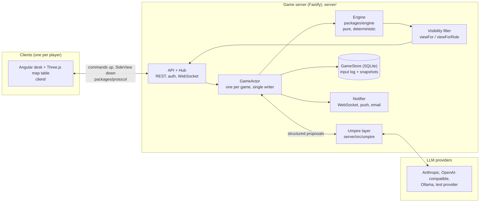
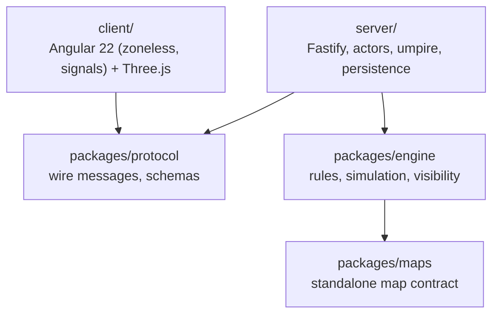
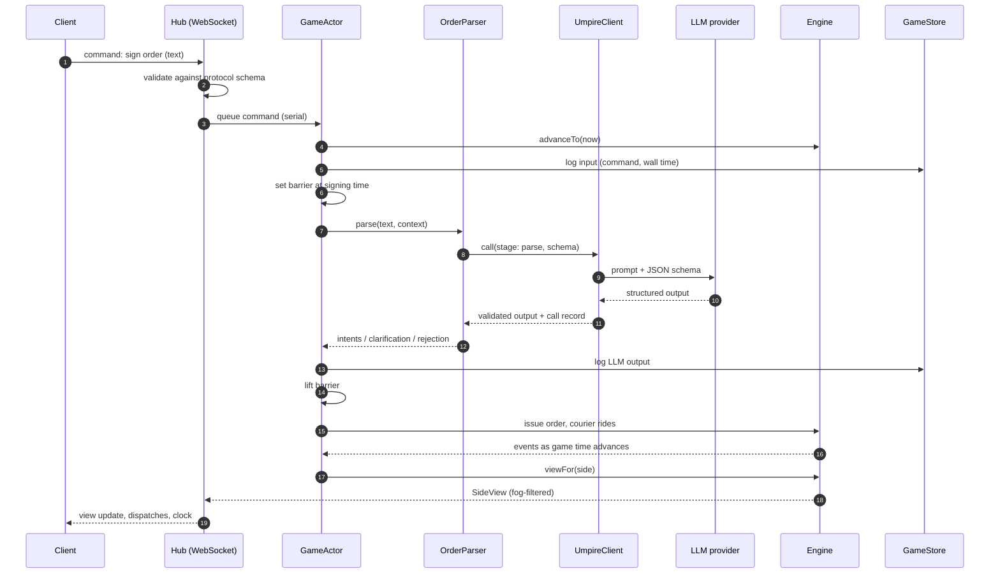
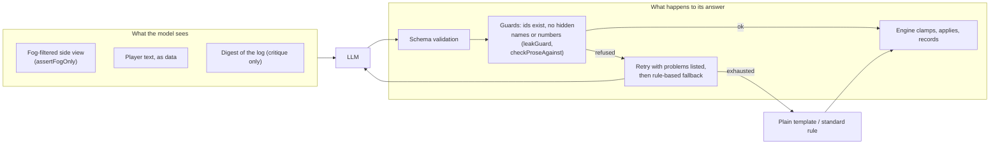
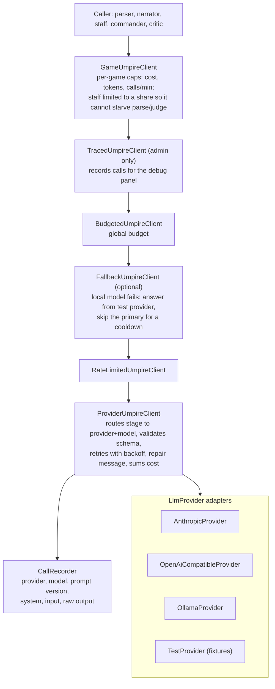
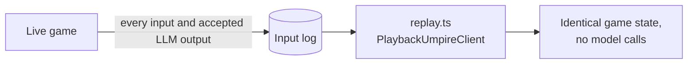
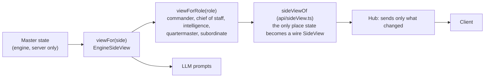

# System overview

A map of how Kriegsspiel fits together: the moving parts, how an LLM is used, and what each
class is responsible for. It is a guide to the code as it stands, not a design proposal. The
reasoning behind each choice is in [decisions.md](decisions.md), and the clock, scheduler and
barrier mechanics are in [architecture.md](architecture.md). Diagrams are Mermaid and render on
GitHub.

## 1. The system at a glance

The rules the whole design hangs on (from [AGENTS.md](../AGENTS.md)):

1. **The engine is pure.** It never reads the wall clock. It only advances to a game time it is
   given.
2. **The LLM never mutates state.** It returns structured proposals; the engine validates and
   applies them. Dice come from the seeded server RNG.
3. **The visibility filter is the only path from master state to a client.** Hidden state is
   never sent. The one exception is the umpire's window after a game has an outcome.
4. **Inputs and LLM outputs are logged**, so any game replays with no model calls.
5. **Game time never advances past an unresolved LLM result** (the LLM barrier).
6. **Clock changes must work** at rates 1, 4, 12 and in manual and fast-forward modes.

## 2. Packages and layers

| Package | Owns | Must not |
|---|---|---|
| `packages/engine` | World state, event queue, movement, contact, combat, morale, supply, couriers, standing orders, roles, forwarding, the visibility filter | Read the wall clock, call the network, hold an LLM |
| `packages/protocol` | Every client/server message and its schema; `SideView` | Contain game rules |
| `server/` | Clock, scheduler, the actor, pause and ratio voting, the umpire (LLM) layer, auth, lobby, notifications, persistence | Mutate state from an LLM result without the engine validating it |
| `client/` | Rendering and input. Shows only what the server sends | Hold or derive hidden state |
| `packages/maps` | The portable, versioned map asset and geometry queries | Read live game state |

## 3. One order, end to end

A player writes an order in free text. This is the path that exercises the clock, the barrier,
the LLM and the visibility filter together.

While the parse is pending, game time is held at the signing time (`GameClock.setBarrier`), so
the outcome never depends on how slow the model was. Other commands keep being served. If the
call fails or times out, it is retried and then replaced by a conservative fallback (nothing is
issued and the player is asked to restate), and that is logged.

## 4. How we use LLMs

### 4.1 What an LLM is allowed to do

An LLM is a **proposal generator behind a schema**. It is never given master state and never
writes it.

Every stage follows the same pattern: the model proposes, a checker refuses anything it was not
shown, a bounded retry follows, and a deterministic fallback means **a missing or weak model
never blocks a game or changes an outcome unpredictably**. Player text is always passed as data,
and prompts say so explicitly (see the prompt-injection corpus in
`server/src/umpire/injection.corpus.ts`).

### 4.2 The stages

`UmpireStage = 'parse' | 'judge' | 'narrate' | 'staff' | 'command' | 'critique'`
(`server/src/umpire/umpireClient.ts`). Each stage routes to its own `{provider, model, params}`.

| Stage | Class / function | Job | Output is checked against |
|---|---|---|---|
| `parse` | `LlmOrderParser` (`orders/llmParser.ts`) | Free-text order to intents, a clarification request or a rejection | Own units and named places only |
| `parse` | `InterpretingParser` / `interpret.ts` | How a subordinate's traits colour an order: `none`, `halt_short`, `exceed`, `clarify` | Engine clamps, gates on traits and rolls on the seeded RNG |
| `judge` | `judgeSituation` | A ruling where the rules are silent: a modifier within a cap, with per-game case law in the prompt | Cap set by the rigid/standard/free dial; engine records a `JudgmentRuling` |
| `judge` | `judgePlacements` | Where units actually stand on continuous ground | Engine's `issuePlacement` checks physical plausibility |
| `narrate` | `narrate.ts` | Turns one report from the fog-filtered list into a period dispatch | Every id, unit, number and capitalised name must be in the input |
| `staff` | `StaffRoster` / `StaffDesk` (`umpire/staff.ts`, `api/conference.ts`) | LLM officers who play empty roles and answer staff-conference questions | Prose checked against what the side was shown; costs game time |
| `staff` | `staffCheck.ts` | The chief of staff reads a shared draft and reports how it will read, what it omits and where it contradicts an earlier order | Ids checked; advice only, never an order |
| `staff` | `DeputyAgent` (`deputy/deputy.ts`) | Acts for an absent player within standing orders and a discretion setting | `deputyProblems` refuses anything past that discretion; refusals are kept for the player's return |
| `command` | `LlmCommander` (`opponent/llmCommander.ts`) | The opposing AI commander, writing orders as free text | Same `OrderParser` humans use; falls back to `ScriptedOpponent` |
| `critique` | `umpire/critique.ts` | Post-game critique from a digest of the log | `checkCritique`: cites must be real fact ids; falls back to `templateCritique` |

### 4.3 The client stack

`createUmpireClient` (`server/src/umpire/createUmpireClient.ts`) is the composition root. Calls
pass through, outermost first:

(`main.ts` builds one shared client with `createUmpireClient`, then `GameClients` makes one
`GameUmpireClient` per game, optionally traced, so every use in a game shares one budget.)

Two further clients exist for tests and replay:

- `MockUmpireClient` serves hand-written JSON fixtures, with configurable latency and failure
  injection, for all non-LLM tests ([umpire-fixtures.md](umpire-fixtures.md)).
- `PlaybackUmpireClient` serves recorded calls with **no provider**, so a replay cannot reach the
  network.

Only the adapters know about a vendor SDK or wire format. To configure or add a provider, see
[llm-providers.md](llm-providers.md).

### 4.4 Recording and replay

A model's accepted output is stored with its model and prompt version. Replaying reads the log,
so a game reproduces without calling a provider. Prompts are versioned constants
(for example `judge-situation-v2`, `narrate-dispatches-v3`, `critique-v1`), and the version is
part of the playback key.

## 5. Information flow and fog

- `viewFor` is the sole producer of a side's knowledge: its own units in full, enemies in sight
  as an id, position and a coarse size, last-known contacts with a growing uncertainty radius,
  delivered reports and captured documents. The full field list is in
  [architecture.md](architecture.md#sideview-contents). Adding a field means updating that list
  and the leak tests in `visibility.test.ts`.
- `viewForRole` narrows that again per staff role, so each role sees only what reaches it.
- LLM prompts are built from the same view, never from master state, and `leakGuard.ts` refuses
  any reply that names the other side's units or commanders.
- Forwarding (`engine/forwarding.ts`) models information sharing as gameplay: a paper reaches
  another seat only when forwarded, after a handling and ride delay.
- The one exception is the **umpire's window** (`api/umpireWindow.ts`), which serves master
  state to a seated player only once the world has an outcome.

## 6. Class and module responsibilities

### 6.1 Engine (`packages/engine`)

| Unit | Responsibility |
|---|---|
| `advanceTo` (`advance.ts`) | Fire every event with `time <= t` in `(time, seq)` order, then set the clock to `t`. Chunking never changes the result |
| `EventRegistry` (`events.ts`) | Register handlers by event type; handlers get the seeded RNG |
| Queue (`queue.ts`) | Persisted priority queue keyed by game time |
| `Rng` (`rng.ts`) | Seeded RNG; the only source of dice |
| `movement`, `navigation`, `terrain`, `geometry` | Routes over vector terrain, terrain costs, roads, fords and bridges |
| `contact`, `combat`, `combatRules` | Contact, fire, melee, flanking, casualties, morale and rout, driven by cited rules tables |
| `supply`, `fatigue` | Supply, fatigue and ammunition |
| `courier` | Courier speed, interception, loss and garbling |
| `orders`, `standing` | Orders as intents, including `when` / `at` conditional and timed orders judged on a unit's own knowledge |
| `judgment`, `placement` | Bounded umpire discretion (clamped, recorded) and placement validation |
| `roles`, `forwarding` | The staff roles, per-role views, and forwarding delay |
| `personality` | Subordinate traits and how they shape an interpretation |
| `visibility` (`viewFor`) | The fog filter; the only producer of a side's knowledge |
| `snapshot` | State as plain JSON for snapshots and recovery |
| `scenario` / `scenarios/` | Loads a scenario into a `GameState` |

### 6.2 Server core (`server/src`)

| Class | Responsibility |
|---|---|
| `GameClock` (`clock.ts`) | Game time from wall time at a rate; pause, rate change, manual and fast-forward; `setBarrier` holds time at a pending dependency. Wall time is injected |
| `GameActor` (`game/actor.ts`) | The single writer for one game. Serial command queue, scheduler, the LLM barrier, snapshot after every command, runs side agents |
| `GameHost` (`game/host.ts`) | Many games in one process; reopens stored games paused |
| `GameStore` / `SqliteGameStore` / `MemoryGameStore` | Append-only input log and periodic snapshots; recovery is latest snapshot plus replay |
| `replay.ts` | Rebuilds a game from its log with no model calls |
| `PauseVoting` (`pause.ts`) | Pause state machine (`running`, `pause_proposed`, `paused`, `resume_proposed`), emergency hold, wall-time deadlines |
| `RatioVoting` (`ratioVote.ts`) | Mid-game clock-ratio change by vote; re-anchors without jumping game time |
| `DraftBook` (`drafts/book.ts`) | A side's shared order drafts: central-sequencer operational transform, comments, tracked edits, read receipts. Pure; the caller passes the time |

### 6.3 API and transport (`server/src/api`, `packages/protocol`)

| Class / module | Responsibility |
|---|---|
| `buildApp` (`api/app.ts`) | Fastify app: `POST /games`, game listing, the per-side WebSocket, lobby, auth, admin, static client |
| `Hub` (`api/hub.ts`) | All WebSocket connections: validates inbound frames against the protocol schemas, sends only `SideView` data and only what changed since the last push |
| `sideViewOf` (`api/sideView.ts`) | Builds the wire `SideView` from the engine's filter, and nothing else |
| `StaffDesk` (`api/conference.ts`) | Which officers are busy, in game time; charges staff questions and draft checks |
| `umpireWindow` | Post-game access to master state, only for a seated player once there is an outcome |
| `packages/protocol` | Command and server-message types and schemas, `PROTOCOL_VERSION` |

### 6.4 Umpire (LLM) layer (`server/src/umpire`, `orders`, `opponent`, `deputy`)

| Class | Responsibility |
|---|---|
| `UmpireClient` (interface) | `call(request)` returns schema-validated output plus a call record. The one seam to any model |
| `ProviderUmpireClient` | Routes a stage to a provider, validates, retries, sums cost |
| `LlmProvider` + adapters | Vendor wire format only |
| `ProviderRegistry` | Constructs adapters from config; add a provider here |
| `RateLimitedUmpireClient`, `BudgetedUmpireClient` | Decorators: rate limit and budget |
| `FallbackUmpireClient` | Answers from the test provider if a local model fails |
| `GameUmpireClient`, `GameClients` | One capped client per game; `report()` gives cost at game end |
| `TracedUmpireClient`, `TraceStore`, `Redactor` | Admin tracing with redaction |
| `MockUmpireClient`, `PlaybackUmpireClient` | Fixtures and recorded replay |
| `OrderParser` (interface) | `parse(text, context)`; the server depends on this seam only |
| `LlmOrderParser`, `StubOrderParser` | LLM parse and the rule-based fallback |
| `InterpretingParser` | Applies subordinate traits after parse |
| `StaffRoster` | LLM officers filling empty roles, with personality traits |
| `LlmCommander`, `ScriptedOpponent` (`SideAgent`) | The opposing commander and its scripted fallback |
| `DeputyAgent` (`SideAgent`) | Stand-in for an absent player within standing orders |

### 6.5 Cross-cutting

| Class | Responsibility |
|---|---|
| `Notifier` (`notify/notifier.ts`) | Spots what is new per seated player and delivers by WebSocket, web push or email, honouring threshold, quiet hours and channels. Text is fixed per event kind and holds no game content |
| `Auth`, `AuthStore`, `Mailer` | Magic-link sign-in, sessions, and the mail transport (`LogMailer` logs the link when no webhook is set) |
| `LobbyStore` | Games waiting to start, seats, roles and pause settings |
| `RateLimiter` (`auth/rateLimit.ts`) | Request rate limiting for the auth routes |

### 6.6 Client (`client/src`)

| Area | Responsibility |
|---|---|
| `app/game` | The persistent Three.js canvas and the map table |
| `app/desk` | The Angular desk layer: in-tray, orders, order of battle, journal, staff conference; `GameService` and `DeskStore` (signals) hold shared state |
| `app/lobby`, `app/shell` | Lobby, new game and the main menu |
| `legacy/net` | WebSocket client and state reduction (`applyServerMessage`) |
| `legacy/desk`, `legacy/table`, `legacy/window` | Framework-free desk logic, table scene, and the post-game window scrubber |

## 7. Where to read next

| Topic | Doc |
|---|---|
| Clock, scheduler, barrier, pause voting | [architecture.md](architecture.md) |
| Decisions and open questions | [decisions.md](decisions.md) |
| How the game plays, roles, collaboration | [gameplay.md](gameplay.md) |
| Desk, map table, rendering | [hq-interface.md](hq-interface.md) |
| Configuring and adding LLM providers | [llm-providers.md](llm-providers.md) |
| Order parsing evaluation | [order-eval.md](order-eval.md) |
| Mock umpire fixtures | [umpire-fixtures.md](umpire-fixtures.md) |
| Container, compose, backups | [deployment.md](deployment.md) |
