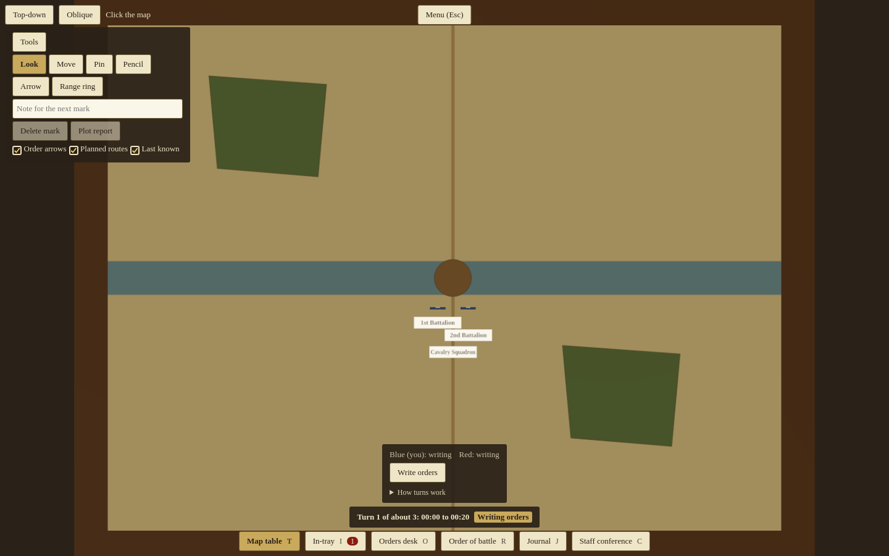
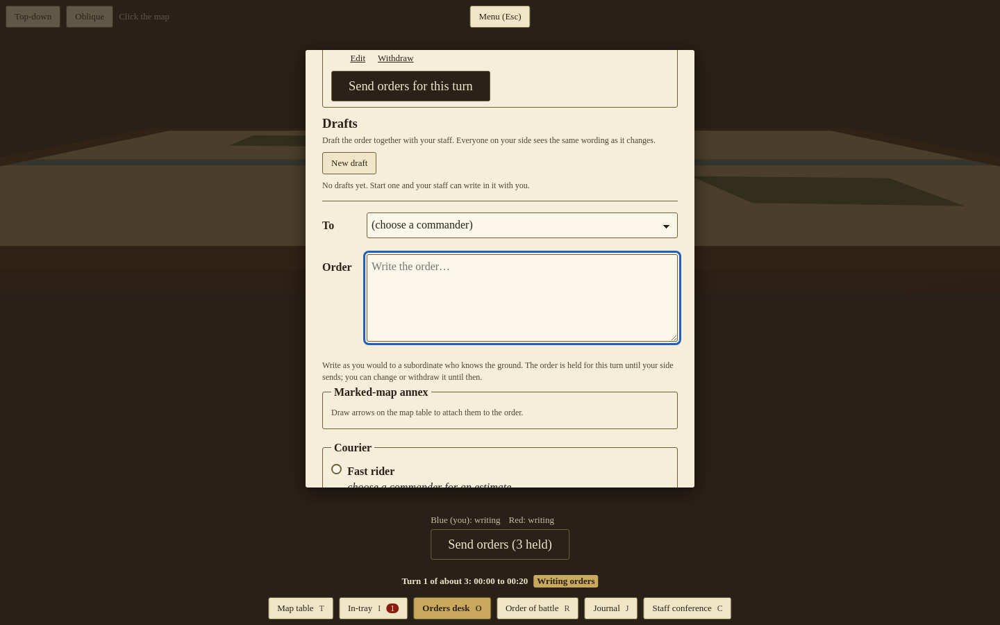
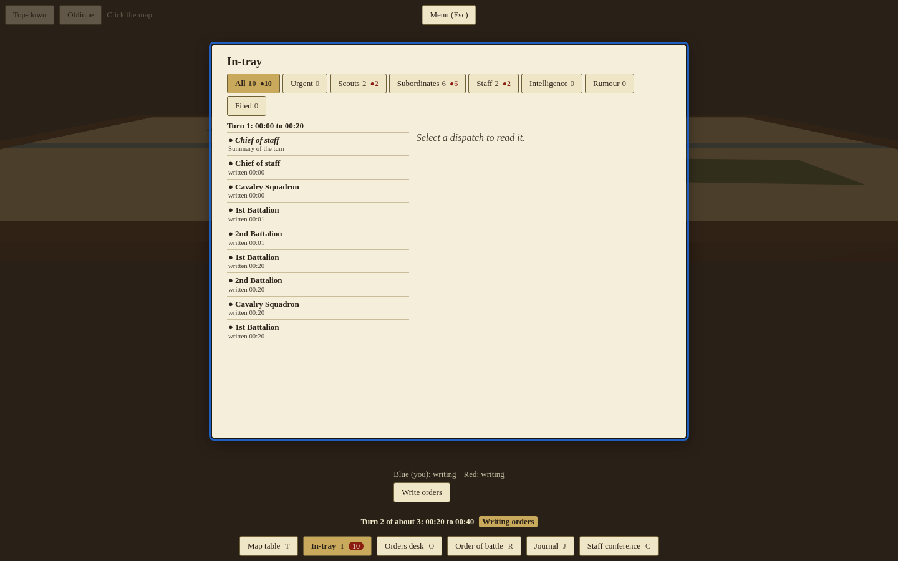
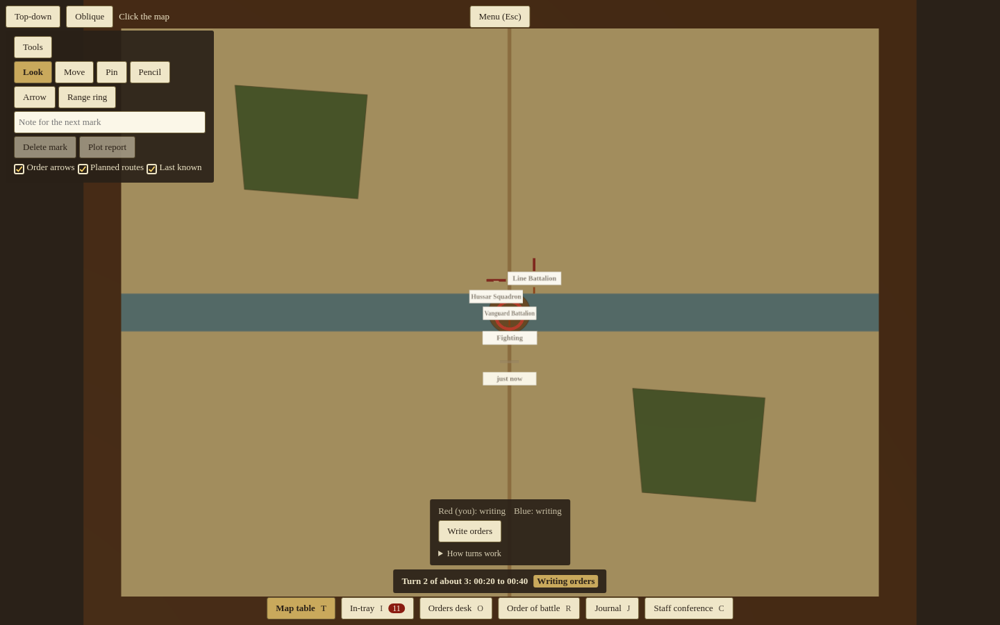
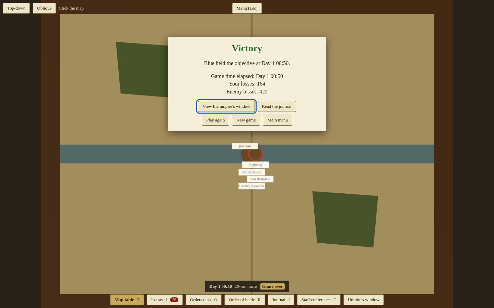
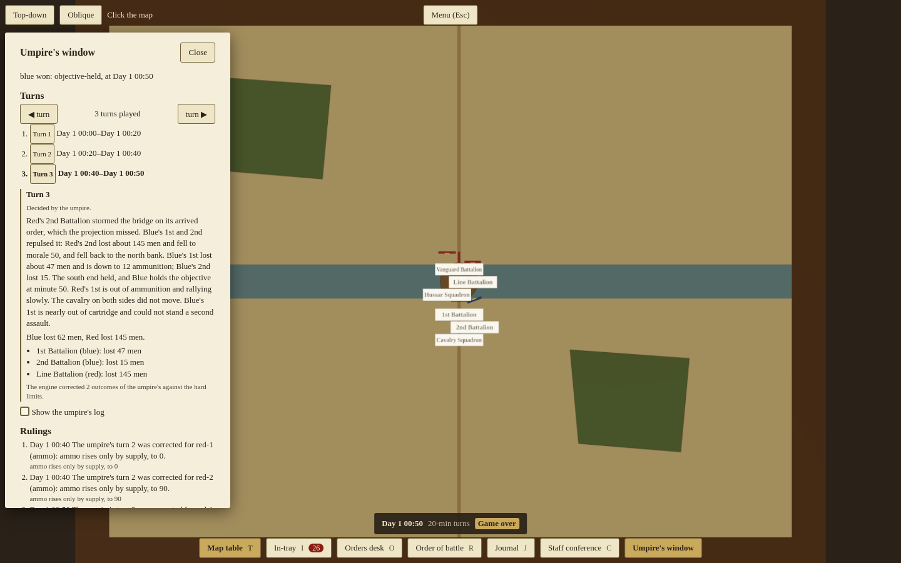
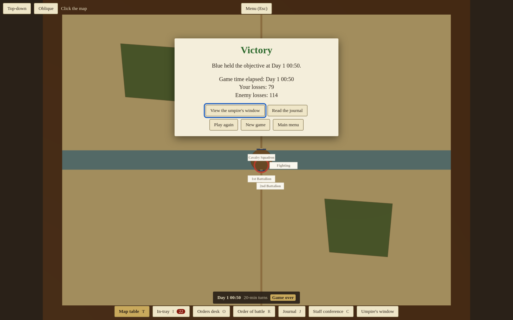
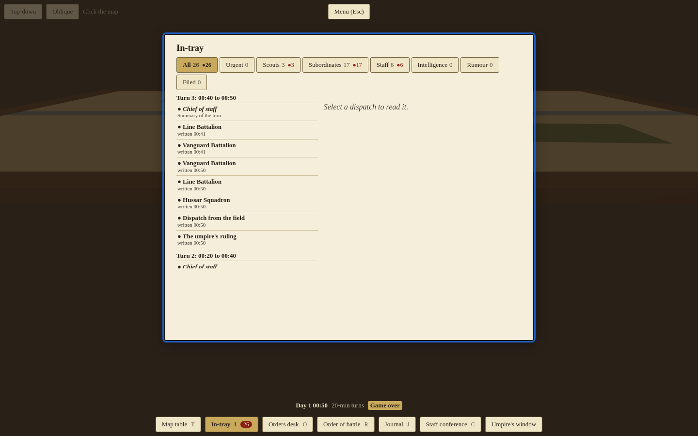
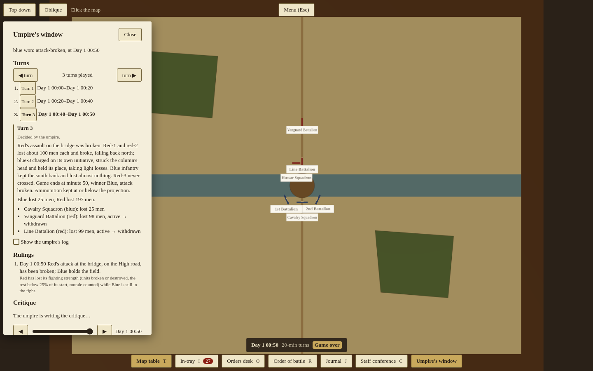

# Turn-mode playtest (11.12, #408)

The last story of Epic 11 (#393): Hold the Bridge played end to end in turn mode, two human seats, the umpire on Claude Code's Sonnet, and the same game at `rigid` for comparison. Played 2026-10-16 on `main` at `a5d0f7f` (rules 3, prompts `adjudicate-v4` and `turn-reports-v1`). Linked from D39 in [decisions.md](decisions.md).

**Verdict in one line:** with Sonnet as umpire the turn game works: every turn resolved, no fallback, no invalid world, every clamp explained, outcomes mostly plausible, about two minutes a turn. Its weak points are the turn reports' text, the rules parser that the `rigid` dial and the projection rest on, and an umpire that never rolls dice. **Recommendation: turn mode stays an option, not the default** ([below](#recommendation)).

## How it was played

- **Server.** The worktree's own server under `devrun` (`devrun up --name t408 --port-env PORT`), its own SQLite file, the built client served from it, the admin view open. Umpire: `UMPIRE_PROVIDER=claude-bridge`, `UMPIRE_MODEL_<stage>=sonnet` for every stage, `CLAUDE_BRIDGE_URL` the host's running bridge (`tools/claude-bridge`, D42) on the loopback. The shared demo was not touched. One game at a time.
- **Seats.** Two signed-in users, Blue's commander (who made the game, `team_vs_team`, `mode: 'turns'`, 20-minute turns) and Red's commander (who joined). Orders were held and sent over each seat's own WebSocket exactly as the orders desk sends them (`holdTurnOrder`, `sendTurn`); each side's papers, units and contacts were read from that side's own socket (`viewUpdate`, `turnState`). Screenshots are from the real client in Chromium (Playwright), one browser context per seat.
- **Players.** One agent played both sides. It wrote each side's orders from that side's view only (its own units, its papers, the enemies in sight, the scenario's public briefing and the map's named places) and played each side to win. It had also read the scenario file, so the "fog" was a discipline, not a wall; the judgements below say where that matters.
- **Games.** Hold the Bridge has a 50-minute limit, so a game is three turns: 00:00 to 00:20, 00:20 to 00:40, and a short last turn to 00:50.
  1. `standard`, Sonnet umpire, orders written turn by turn.
  2. `rigid`, the same orders (Blue's cavalry orders adapted, since the tables left it on the far bank).
  3. `free`, Sonnet umpire, a different plan on each side (Red concentrates and assaults with both battalions together; Blue puts both battalions at the bridge-end).
- **Not played: a local model.** 11.2 (#398, #440) found no local model this host can run that is usable as the turn umpire (`qwen2.5:7b`, `llama3.1:8b` and `gemma4:e4b` failed every case and took 13 to 44 minutes a turn), so no local-model game was played.
- **Cost.** The bridge reports zero cost on a subscription, so the tables give tokens. "Prompt" is what the CLI reports as cache read plus cache write (its `inputTokens` is 2 on every call, as the prompt is all cached).

## Results

| Game | Dial | Winner, reason, time | Blue lost | Red lost | Umpire turns | Fallbacks | Clamps (rulings) | Rolls | Model calls | Prompt / output tokens | Wall per turn |
| --- | --- | --- | --- | --- | --- | --- | --- | --- | --- | --- | --- |
| 1 | `standard` | Blue, objective held, 00:50 | 164 | 422 | 3 of 3 | 0 | 4 (2 ammo, 2 position) | 0 | 18 (6 adjudicate, 12 report) | 72.8k / 38.0k | 137, 126, 93 s |
| 2 | `rigid` | Blue, objective held, 00:50 | 79 | 114 | 0 of 3 | - | 0 | - | 0 | 0 | 1.0 s each |
| 3 | `free` | Blue, attack broken, 00:50 | 40 | 262 | 3 of 3 | 0 | 0 | 0 | 17 (5 adjudicate, 12 report) | 62.9k / 24.7k | 71, 112, 75 s |

Every game ran to its outcome; no turn fell back to the tables; the admin Turns API and a replay of each log rebuilt every turn with no model; and at every turn end the world was valid: no unit gained men or came back from the dead, every unit stood on passable ground, no two friendly units overlapped, morale, fatigue and ammunition stayed in 0 to 100 (`server/src/game/playtest408.test.ts`).

**Latency.** An umpire turn took 71 to 137 s from the second side's send to its next turn (median about 110 s). Adjudication was one call of 26 s or two of 20 to 45 s each (two in five of six turns: the resend); the reports were four calls of 3 to 15 s, made one after another (each side's call, then a second call for the notes the checks refused, every time). A `rigid` turn takes a second. Per bridge call: adjudicate 20 to 45 s for 2.6k to 5.5k output tokens on a 7.4k to 8.3k-token prompt; a report call 3 to 15 s for 0.1k to 1.4k output on 1.6k to 2.9k.

## Game 1: `standard`

Blue: hold the south end with the 1st Battalion, the 2nd east of it on the bank, the cavalry to scout over the bridge and come back. Red: Hussars ahead to the river, the Vanguard down the road to take the bridge, the Line Battalion behind it.

| Turn | Calls (s) | Resend: problems in the first reply | Clamps | Departures from the projection (all with reasons) | Blue / Red lost | Outcome |
| --- | --- | --- | --- | --- | --- | --- |
| 1, 00:00-00:20 | adjudicate 42 + 44, reports 12 + 12 (Blue), 13 + 14 (Red) | Blue 2nd placed in the river; ammunition 70 above the projected 40 for both battalions in the fight; four observations the sight test refused; Red's Hussars moved 1 km with no departure reason | 0 | Blue cavalry (came back south instead of standing over the bridge); Red's Line Battalion and Hussars (their orders had arrived; the rules could not read them) | 43 / 62 | Vanguard on the north end of the bridge, Blue's 1st at the south end; fire across the water |
| 2, 00:20-00:40 | 33 + 41, reports 14 + 13, 12 + 13 | Blue 1st and 2nd overlapping; Blue 2nd and Red Line Battalion in the river; Red Vanguard ammunition above the projection; Line Battalion moved without a reason | 2: Red Vanguard ammunition 25 to 0, Line Battalion 95 to 90 (above the projection, #436) | Blue 1st (heavier loss for a bayonet fight), Blue cavalry (could not pass the infantry on the bridge), Red Vanguard (the projection annihilated it; the umpire: repulsed with 210 lost, shaken, not routed), Red Line Battalion | 59 / 215 | Vanguard's bayonet assault over the bridge thrown back by the 1st's front and the 2nd's flank volley |
| 3, 00:40-00:50 | 21 + 29, reports 11 + 11, 13 + 9 | Red 1st and 2nd overlapping | 2: Red Vanguard and Line Battalion overlapping at the north end; the Line Battalion is put back where it started | Blue 1st, Blue 2nd, Red Line Battalion (the projection left it idle; its storming order had arrived) | 62 / 145 | Line Battalion storms and is repulsed; Blue holds the objective at the time limit |

Couriers: every order arrived within 2 minutes in turns 1 and 2. In turn 3 Blue's order to its cavalry was lost (a 1.2 km ride behind its own lines), and Red's order to its Hussars was "intercepted by blue-3", Blue's cavalry standing south of the river (#531).

**The umpire's journal.** Precedents: turn 1 "Units stay on the banks, not in the river; the bridge is the only crossing, and a unit may stand on it only when crossing." and "An order that has arrived is acted on, even where the projection left the unit idle."; turn 2 "Units keep clear of the river itself: the banks lie at y=1400 and y=1600, and a unit stands on the bridge only when crossing." (a restatement the journal kept, since the text differs) and "A bayonet assault over the bridge against a steady line is repulsed with heavy loss, not annihilation, and the repulsed battalion falls back shaken, not routed."; turn 3 none. The turn 3 departure cites the turn 2 precedent by name ("Per the precedent of turn 2, the assault was repulsed with heavy loss"): the journal did its job.

**Reports.** Blue's turn 2, as read: "Sir, the enemy column came over the bridge at the double and struck my line at the south end. I held, gave volleys at close range as ordered, and threw him back across. I lost 55 men and the battalion is shaken. Powder is running low, and I will not waste it on long shots." Red's: "Sir, my battalion moved against the bridge and lost 210 men. Your orders were carried out only in part. The men are wavering and tired, and our ammunition is nearly gone, which you should weigh before asking more of us." Of 36 unit accounts in the two umpire games the screen withheld 10, each on a harmless word (#530), and 9 notes were refused twice and kept their template text.

**Judgement, as Blue.** Turn 1: plausible (5/5); a battalion in line at the bridge-end trading fire with one deploying on the far bank, the scouts back in time. Turn 2: plausible (4/5); a column on a 200 m bridge against a line and a flank battalion should be beaten, and 55 men for the defender is fair. Turn 3: plausible (4/5). The reports told me what I needed (where my units stood, what they lost, that the 1st was nearly out of powder) but two papers were wrong: the 1st's acknowledgement at 00:01 already said it was "shaken and short of powder" before a shot was fired (#532), and the cavalry's turn 1 note said "We are crossing the bridge to scout" after it had come back (#530). Reports 3/5.

**Judgement, as Red.** Turn 1: plausible (4/5), though the losses across 200 m of water (62 men) are high for musketry at that range. Turn 2: plausible (4/5): the engine wanted the Vanguard annihilated and routed 1.1 km; the umpire's "thrown back with 210 lost, shaken" is the better ruling, and its reason says why. Turn 3: plausible (4/5); my second assault was piecemeal and deserved to fail. My mistake was to send the battalions one at a time, which the game let me make. Reports 3/5: honest about losses, but the Vanguard's turn 2 acknowledgement (written at 00:21) spoke of "ammunition nearly gone", true only at 00:40.

## Game 2: `rigid`

The same orders, decided by the tables: the rules parser (#522) reads each order, the engine carries out what it read. It read 4 of the 18 orders (Blue's 1st to the bridge-end, Blue's cavalry to the far end of the bridge, Red's Vanguard to the bridge in turn 1, and "Form line on the north bank just east of the bridge" in turn 2, read as a hold at a point in the river, which left the Line Battalion where it stood). Everything else was "no new order" ("Which river, sir?", `I know of no place called "bayonet"`, "attack orders are not modelled yet", a condition after the first verb).

| Turn | Blue / Red lost | What happened |
| --- | --- | --- |
| 1 | 43 / 62 | The Vanguard on the middle of the bridge, the 1st at the south end; Blue's cavalry, sent "north along the High road", stops at the bridge's north end, behind the enemy. The Line Battalion and the Hussars never move. |
| 2 | 33 / 48 | The same fire fight. Blue's cavalry, on the north bank, takes Red's courier to the Vanguard (its storming order never arrives; Blue reads it at 00:31). |
| 3 | 3 / 4 | Nothing new; Blue holds the objective at the time limit. |

The first turn's losses are exactly the standard game's (the umpire kept the engine's fire fight there). After that the two games part: under the tables four of six units never moved and the game was decided by one battalion a side. As either player, `rigid` with written orders is not a game: 3 of 18 orders did anything. The comparison says more about the rules parser than about the dial (#536).

## Game 3: `free`

Red: both battalions to 300 paces short of the bridge, Hussars west along the river looking for a ford; then fire for ten minutes and assault together in column, Line Battalion behind the Vanguard; then push on. Blue: both battalions in line at the bridge-end either side of the road, cavalry in reserve; then flank fire and a charge on the column's head.

| Turn | Calls (s) | Resend | Clamps | Blue / Red lost | Outcome |
| --- | --- | --- | --- | --- | --- |
| 1 | adjudicate 26, reports 13 + 9, 15 + 10 | none | 0 | 0 / 0 | Both deployed; the Hussars ride a mile west, find "no ford and no crossing, only steady deep water" |
| 2 | 37 + 45, reports 8 + 9, 8 + 4 | the Line Battalion placed in the river | 0 | 15 / 65 | Fire across the river "beyond range"; at 00:34 the Vanguard forms column and is mid-bridge, on the objective, at the turn's end, the Line Battalion behind it |
| 3 | 26 + 24, reports 7 + 8, 6 + 3 | ammunition above the projection (three units) | 0 | 25 / 197 | The Vanguard is shot to pieces coming off the bridge and charged by Blue's cavalry (acting without orders: its courier was lost); it breaks back into the Line Battalion and both break. Blue wins, attack broken |

Precedent: "Banks lie at y=1400 and y=1600; fire across the river from the banks is beyond 200 m and ineffective unless units stand on the bridge."

**Judgement, as Red.** Turns 1 and 2 plausible (5/5 and 4/5); the assault frozen mid-bridge at the turn's end is the turn structure showing, and the umpire left it unresolved rather than deciding it early, which is right. Turn 3: the result is plausible, the price is not (2/5): both battalions broke on about 100 casualties each, while Blue's two battalions, firing at close range into a bayonet assault, lost no men at all and the cavalry 25. A free umpire may decide a broken assault, but this was the moment for a roll and none was asked (#535).

**Judgement, as Blue.** Plausible but flattering (3/5 for turn 3). The papers were the best of the three games: every account narrated in turns 1 and 2, specific and in character ("I did not fire at the far bank, as the enemy stood beyond range and you forbade wasting powder"). Reports 4/5.

## Where the umpire contradicted itself, the map, or what a side could know

| Where | What | Follow-up |
| --- | --- | --- |
| Game 1, turn 1 | The precedent says a unit may stand on the bridge only when crossing, and the summary says the Vanguard "is on the north bank at y=1420, not on the bridge"; but y=1420 is on the bridge (the bank is at y=1400, as its own turn 2 precedent says). The validator allows it (a bridge is passable). | #535 (give the umpire the banks) |
| Game 1, turns 1-3; game 3, turn 2 | First replies put units in the river (y between 1400 and 1600 off the bridge) four times; the march check refused each and the resend moved them. In turn 3 the umpire's own outcome for the Line Battalion (y=1405) broke its own precedent. | #535 |
| Game 1, turn 1 | The summary says "Ammo is as projected: 40" while the reply's outcomes had 70; the resend fixed the outcomes. | #436 |
| Game 1, turn 1 | Red's Hussars: all three observations refused by the sight test, but the account ("I saw infantry in line at the south end of the bridge, with a second battalion and some cavalry behind it") reached Red's in-tray. Red lost nothing (its Vanguard saw the same units), but an account can carry a sighting the engine refused. (On replay: the sightings were refused in the first reply only; the resend's outcome let all three stand, so the account Red read rested on stood sightings. Since #533 such an account is sent back and, if it stays, withheld.) | #533 |
| Games 1 and 3, every turn with a fight | Acknowledgements written in the turn's first minutes carry the condition at its end ("shaken and short of powder" at 00:01). | #532 |
| Games 1 and 3 | Contact notes turn the report's position radius into a distance: "It lies within twenty metres of us" of an enemy 200 m away across the river. | #532 |
| Game 1, turn 1 | Blue's cavalry note "We are crossing the bridge to scout north" after it had come back (account withheld on "1st Battalion"); game 1, turn 2, a note ends "I can say no more than that in this note." | #530 |
| Games 1 and 3, turn 3 | Blue's cavalry, south of the river, intercepts Red's courier riding on the north bank; Blue reads Red's order "taken from a courier near the bridge". | #531 |
| Games 1 and 3 | The same courier luck in both umpire games (all turn 1 rides at the same minutes; Blue's turn 3 cavalry order lost at 00:40:42, Red's intercepted at 00:41), since every game has the scenario's seed. | #534 |
| Game 3, turn 3 | A decisive bayonet assault and cavalry charge decided with no roll; the defenders' infantry lose no men. | #535 |

No umpire turn left a side knowing an enemy unit's name or strength, the umpire's summary, journal or rulings; no fallback notice was needed.

## Every clamp, explained

| Game, turn | Unit, field | Proposed, applied | Why |
| --- | --- | --- | --- |
| 1, 2 | Red Vanguard, ammunition | 25, 0 | The projection fired the Vanguard's last rounds; ammunition rises only by supply, and the projection is the ceiling (D39). The umpire's turn 3 then has the Vanguard "out of ammunition", so it followed the clamped state. Whether the ceiling should be the `T0` value is #436. |
| 1, 2 | Red Line Battalion, ammunition | 95, 90 | The same rule; the projection had it fire a little at long range. |
| 1, 3 | Red Vanguard, position | (2050, 1360), unchanged | Ended overlapping the Line Battalion at the north end of the bridge; the one that moved goes back (D39 "As built (11.5)"). |
| 1, 3 | Red Line Battalion, position | (2055, 1405), (2130, 1385) | The other half of the same overlap: it is put back at its `T0` place, so its turn paper says it moved 0 m though it stormed the bridge and came back. |

Game 3 had no clamp. Neither game fell back. In five of six umpire turns the first reply had problems and the one resend corrected all but these four.

## The turn reports, read as a player

What works: each side hears from each of its units once a turn, in the officer's voice, with the order's result ("carried out only in part"), losses, and what was seen; the desk's status cards, summary paper and in-tray by turn (#439) make a three-turn game easy to follow (screenshots below). The game-over paper and the umpire's ruling arrive at the turn's end.

What does not: the text faults in the table above, ten withheld accounts out of 36 on harmless words, nine notes refused twice, and two report calls per side every turn (#536, #537). The lost-courier paper for Blue's turn 3 order never came, because its overdue time fell after the game's end (#438's rule, as designed); the cavalry's own note ("standing idle sits ill with me") was the only hint.

## Screenshots

- Standard, turn 1: Blue's table and the turn panel 
- Standard, turn 1: Blue's orders desk with three held orders 
- Standard, turn 2: Blue's in-tray, papers grouped by turn with the staff's summary first 
- Standard, turn 2: Red's table, the fight at the bridge marked 
- Standard, end: the game-over paper 
- Standard, after the game: the umpire's window, turn by turn, with the corrections 
- Rigid, end 
- Free, end: Red's in-tray 
- Free, after the game: the umpire's window 

## Replaying the games

The three games' input logs, exported from the server's SQLite store with the state each ended in, are fixtures: `server/src/game/playtest408/standard.json`, `rigid.json` and `free.json` (`{ header, entries, final }`, the shape of the other log fixtures; each umpire turn's entry carries the proposal, rolls, rulings, journal context and every call's prompt input and raw reply, and each side's `turnReports` entry its notes). `server/src/game/playtest408.test.ts` replays each to its recorded final state and outcome with no model, and checks every turn end with the admin Turns view's replay (`replayTurns`). The orders as sent are also in `docs/turn-playtest-evidence/orders/` (one file per game and turn). To look at a game in the admin view, import its log into a server's store, or read the fixture's `resolveTurn` entries directly.

Game ids on the playtest server (not kept): standard `7b523e13-d0c7-4b89-a80e-ad966e9cc723`, rigid `454fdb3b-94d1-40e4-8ff9-b3667de8253c`, free `1ea6b35d-2d35-45a5-945d-0c58308aaa83`.

## Recommendation

**Turn mode stays an option; it does not become the default yet.** Reasons:

1. **It needs a capable model, and the default server has none.** With Sonnet it is the better game for written orders: the umpire read every order as a staff officer would (each of the 32 orders that arrived in the umpire games was carried out, carried out in part with the reason, or acted on as its commander would), where the tables read 4 of 18 and left four of six units idle. But the keyless demo has no usable local model (11.2), and there turn mode is the `rigid` game, which is worse than real time with the same orders (the real-time parse stage at least has a model). A default must work on the default server.
2. **The engine kept the record and the limits.** Six umpire turns, no fallback, no invalid world, four clamps, all explained, and three games that replay with no model. D1's objection (inconsistent, unauditable) is answered; this part needs no further iteration.
3. **The umpire's judgement is good but not yet trustworthy at the decisive moment.** Five of six turns plausible (4/5 or better from both sides); the sixth decided a broken assault with no roll and no defender loss. It never asked for dice. That and the river placements are prompt work (#535).
4. **The reports are the weakest part.** Players live in the in-tray, and a quarter of the accounts were withheld on harmless words, acknowledgements report the future, and contact notes misstate distances (#530, #532, #533). These are fixable checks and inputs, not design changes.
5. **The pace is fine for its purpose.** About two minutes a turn is fast for a game played by appointment or by deadline, and three turns make a 50-minute battle in under ten minutes of waiting. Running the report calls concurrently (#537) would take a third off.

Revisit the default after #530, #532, #533 and #535 (report quality and the umpire's dice), and once a server without a Claude model has a usable umpire; the `rigid` dial needs #536 before it is a fair comparison or a fallback players would accept.

## Follow-ups filed

#530 (account screen false positives), #531 (interception across the river), #532 (acknowledgement condition and contact distances), #533 (accounts carry refused sightings), #534 (one seed per scenario), #535 (umpire rolls and river placements), #536 (rules parse of real turn orders), #537 (report calls concurrent, one per side), #538 (ruling punctuation, unit ids in the window). Already open and confirmed here: #436 (ammunition ceiling: two of the four clamps, and resends in three turns), #523 (departure reasons).
